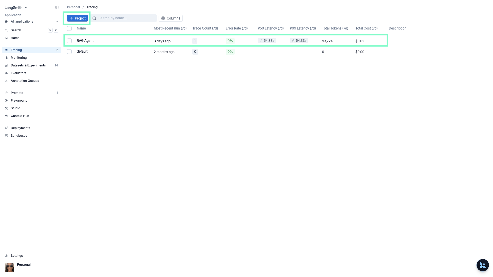
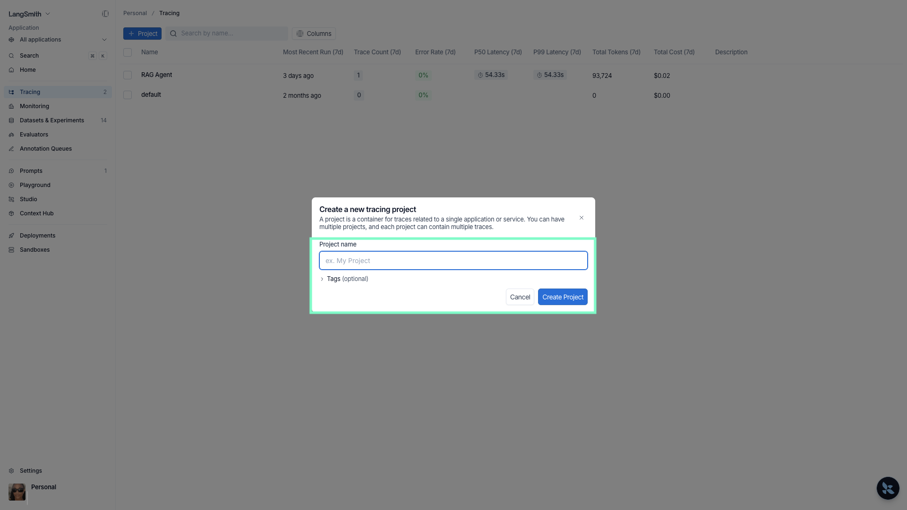
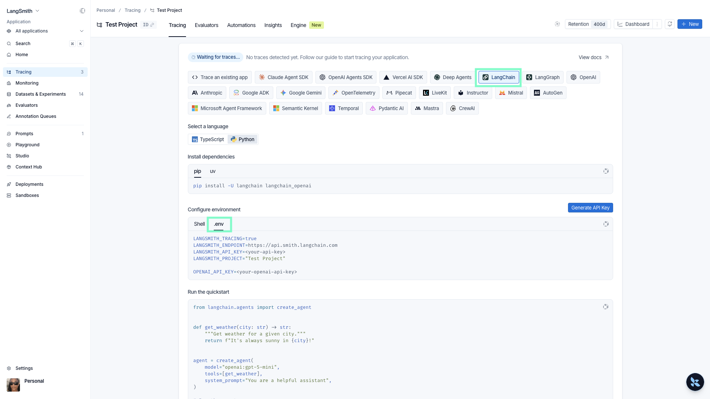

# Master RAG: Ultimate Retrieval-Augmented Generation Course


1. Setup and Python installation 
2. Create and Activate a Virtual Environment
3. Create API keys & set the environment variables 
4. Start uvicorn server

### [1]-Setup and Python installation

#### macOS
1. **Check if Python is already installed**
   ```sh
   python3 --version
   ```
   If Python is not installed, proceed with the steps below.

2. **Install Homebrew (if not installed)**
   ```sh
   /bin/bash -c "$(curl -fsSL https://raw.githubusercontent.com/Homebrew/install/HEAD/install.sh)"
   ```

3. **Install Python**
   ```sh
   brew install python3
   ```

4. **Check Python Version**
   ```sh
   python3 --version
   ```

#### Windows
1. **Download Python** from the official website: [https://www.python.org/downloads/](https://www.python.org/downloads/)

2. **Run the installer** and check the box **"Add Python to PATH"** before proceeding with the installation.

3. **Check Python Version**
   ```sh
   python --version
   ```
---

## [2]-Create and Activate a Virtual Environment

#### macOS
1. **Navigate to your project directory**
   ```sh
   cd /path/to/your/project
   ```

2. **Create a virtual environment**
   ```sh
   python3 -m venv .venv
   ```

3. **Activate the virtual environment**
   ```sh
   source .venv/bin/activate
   ```

4. **Verify that the virtual environment is active** (you should see `(venv)` in the terminal prompt).

#### Windows
1. **Navigate to your project directory**
   ```sh
   cd C:\path\to\your\project
   ```

2. **Create a virtual environment**
   ```sh
   python -m venv .venv
   ```

3. **Activate the virtual environment**
   ```sh
   .venv\Scripts\activate
   ```

4. **Verify that the virtual environment is active** (Command Prompt should show `(venv)` before the directory path).

---

## Deactivating the Virtual Environment
For both macOS and Windows, deactivate the virtual environment by running:
```sh
 deactivate
```

---

### [3]-Package Installation
(Mac)
```sh
pip3 install -r requirements.txt

export PYTHONPATH=$PYTHONPATH:/path/to/autogen_agentchat
```

(Windows)
```sh
pip install -r requirements.txt
```

---

## Exiting the Virtual Environment
Simply run:
```sh
deactivate
```


### [3]-Create API keys & set the environment variables 


#### 3.1 Setting Up OpenAI Secret Key  
1. Create an OpenAI Account[OpenAI's API Keys page](https://platform.openai.com/signup/),
2. Go to [OpenAI's API Keys page](https://platform.openai.com/settings/organization/api-keys),
3. Click **Create new secret key** and copy it, 
4. You will need to add your billing information (MANAGE > Settings > Billing).  


#### 3.2 LangSmith
1. Create a [LangSmith Account](https://smith.langchain.com/),
2. Select **Tracing** from the sidebar menu and **Create a new project**

**3.2.1 Create a project**


**3.2.2 Provide a name**


**3.2.3 Configure Project**


#### Set environment variables 

##### macOS & Linux  
You can store the key in your shell configuration file:  

```sh
echo 'export OPENAI_API_KEY="your-secret-key"' >> ~/.bashrc
source ~/.bashrc
````

or add to `.env` file (update the `.env.example` file)

```sh
OPENAI_API_KEY="YOUR_OPENAI_API_KEY_H"
LANGSMITH_TRACING=true
LANGSMITH_ENDPOINT=https://api.smith.langchain.com
LANGSMITH_API_KEY="YOUR_LANGSMITH_API_KEY"
LANGSMITH_PROJECT="PROJECT_NAME"

```


### [4]-Start uvicorn server

`uvicorn server:app --reload --port 8000`