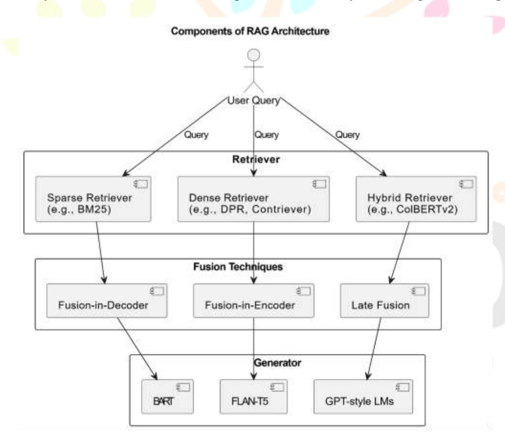
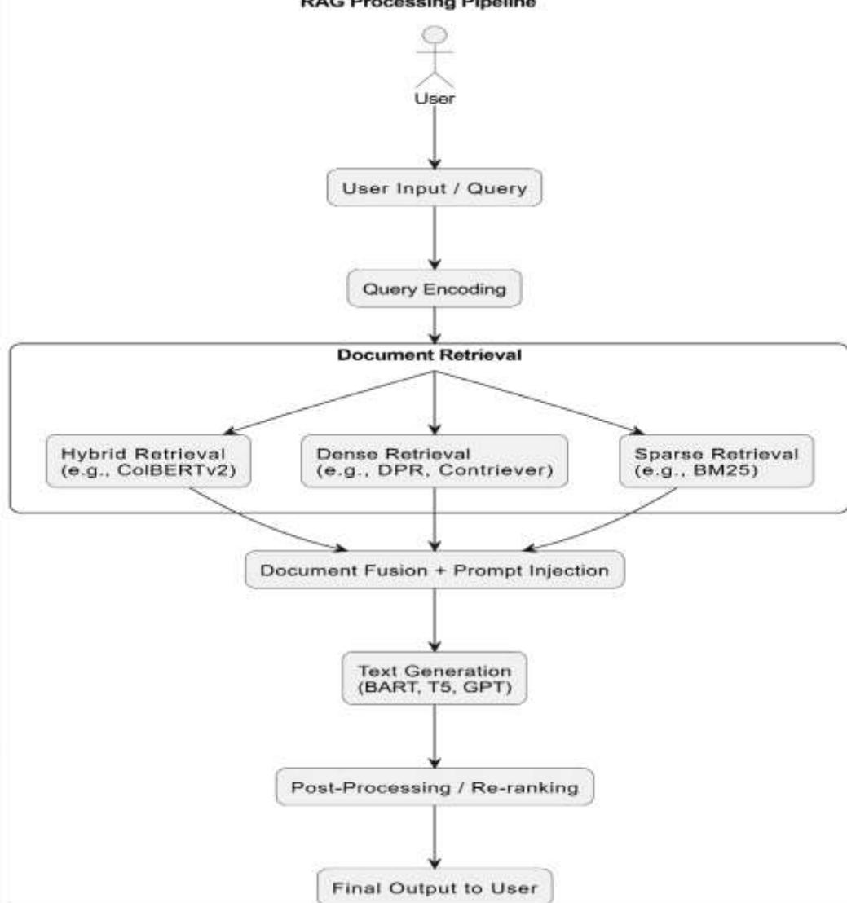

# **Retrieval-Augmented Generation (RAG): Trends, Architectures, and Use Cases** *A Comprehensive Study*

# **Anushka Rai**

# **Abstract**

Retrieval-Augmented Generation (RAG) is an emerging approach that enhances language models by integrating document retrieval into the generation process. This paper provides a comprehensive study of RAG systems, examining their architecture—comprising retrievers, fusion techniques, and generators—and their performance across knowledge-intensive tasks. We explore the historical development of RAG, compare traditional language models with RAG pipelines, and analyze use cases in healthcare, law, education, and enterprise settings. The study further discusses retrieval and generation methods, optimization strategies such as re-ranking and prompt rewriting, and evaluates model performance using metrics like Recall@k, ROUGE, and FEVER. While RAG addresses key limitations of traditional LLMs, such as hallucination and static memory, challenges remain in retrieval precision, latency, and corpus freshness. The paper concludes by reflecting on RAG's practical value and future potential as a foundation for more grounded and reliable AI systems.

# **Introduction**

Retrieval-Augmented Generation, or RAG for short, is a method that helps computer systems give better answers by first searching for useful information before responding. Instead of relying only on what the system already knows, RAG looks things up—kind of like checking notes before answering a question. This makes the final response more accurate, detailed, and grounded in real information. [\[1\]](https://aws.amazon.com/what-is/retrieval-augmented-generation/)

On their own, many systems can write well but don't always have the right facts. That's where retrieval comes in. By pulling in relevant information first, and then using that to guide the response, the system can be more helpful and trustworthy. It's like having a conversation with someone who doesn't just guess—but takes a moment to double-check before answering. [\[2\]](https://cloud.google.com/use-cases/retrieval-augmented-generation)

Today, people expect answers that aren't just fluent—but also correct and backed by facts. Whether it's helping someone with a health question, explaining a legal term, or just answering a tricky technical problem, there's a real need for systems that can think and fact-check at the same time. RAG is becoming more popular because it helps meet this need—it makes responses not only sound smart but actually be smart. [\[1\]](https://aws.amazon.com/what-is/retrieval-augmented-generation/) [\[2\]](https://cloud.google.com/use-cases/retrieval-augmented-generation)

Older systems that generate responses often make things up. They don't mean to—they just don't always know what's real and what's not. Sometimes they "hallucinate" facts or give outdated information because they can't search for anything new. That's a problem when people are relying on them for real answers. RAG helps fix this by combining the best of both worlds: the ability to explain things clearly, and the ability to look things up when needed. [\[1\]](https://aws.amazon.com/what-is/retrieval-augmented-generation/)

In many areas today—like healthcare, research, customer support, or education—people often need detailed, factbased answers. These are known as knowledge-intensive tasks because they require more than just general information; they demand specific, often up-to-date details that are easy to verify and explain. This is where traditional systems often fall short. They might generate a response that sounds convincing, but that doesn't mean it's always correct. One of the main challenges with older systems is that they rely entirely on what they were trained on, without the ability to check or update their knowledge. Think of it like answering questions using only a textbook from five years ago. A lot can change in that time—and that's a big limitation. Retrieval-Augmented Generation (RAG) helps solve this by letting systems look up real information while forming a response. This not only improves the accuracy of the answer but also allows it to include details the system might not "remember" on its own. As a result, responses become more consistent with facts, and users can better understand where the information is coming from. Compared to traditional language systems—often called "vanilla" models—RAG offers a smarter way forward. Instead of just guessing based on past training, it combines memory with research. It's like the difference between someone answering from memory and someone who quickly double-checks the latest sources before speaking. That's why RAG is becoming more important, especially as people rely more and more on systems for trustworthy and informed responses. [\[3\]](https://arxiv.org/abs/2410.12837)

#### **1.2.Global Trends and Market Impact**

The growing demand for accurate, real-time, and domain-specific information has led to a rapid rise in the adoption of retrieval-augmented generation (RAG) architectures, particularly within enterprise and commercial applications. Organizations are increasingly integrating enterprise search solutions with generative models to build intelligent systems capable of answering internal knowledge base queries, supporting customer service, and enhancing productivity across departments. These deployments highlight a significant shift from static, fine-tuned models to more dynamic and modular retrieval-augmented pipelines[.\[7\]](https://www.gartner.com/en)

A key factor driving this trend is the widespread adoption of vector search technologies and semantic indexing enabled by scalable tools like Faiss, Weaviate, and Pinecone. These systems allow efficient retrieval of relevant documents from large unstructured corpora using dense embeddings generated by pretrained language models. In tandem, LLM pipelines that combine retrieval, generation, and response ranking—using frameworks like LangChain and Haystack—have become increasingly popular in real-world deployments. [\[4\]](https://python.langchain.com/docs/introduction/)

Another important development is the rise of hybrid retrieval models, which combine both sparse (e.g., BM25) and dense (e.g., DPR, Contriever) retrieval techniques to improve both precision and recall in information retrieval. These models ensure that generated outputs are more accurate, factually grounded, and contextually aligned with user intent. [\[5\]](https://arxiv.org/abs/2304.01282)

A prominent example of RAG in action can be seen in OpenAI's implementation of retrieval-based tools within ChatGPT. Features like the Browsing tool, code interpreter (Advanced Data Analysis), and plug-in ecosystem leverage external information sources to enhance the capabilities of the model beyond its training cut-off. These tools demonstrate how RAG-like designs are becoming central to making large models more useful, up-to-date, and task-specific across a wide range of industries. [\[6\]](https://help.openai.com/en/articles/6825453-chatgpt-release-notes)

As RAG continues to scale across sectors—finance, legal, healthcare, education, and customer support—the market is witnessing a convergence of search infrastructure, large-scale language models, and modular AI design, pointing toward a future of more reliable, explainable, and knowledge-integrated systems.

# **2. Objectives**

The purpose of this study is to provide a comprehensive understanding of Retrieval-Augmented Generation (RAG) and its growing role in the development of knowledge-grounded response systems. As RAG continues to be adopted in various fields, it becomes essential to examine how it has evolved, how it is being implemented, and what value it offers across different use cases. The main objectives of this paper are outlined as follows:

**To trace the evolution of RAG architectures To compare major RAG frameworks and emerging trends** **To analyze real-world use cases. To evaluate the core benefits, known limitations, and future directions** 

# **3. Overview**

# **3.1.Historical Timeline of RAG Development**

| Year | Milestone                                                                                                                                                             |
|------|-----------------------------------------------------------------------------------------------------------------------------------------------------------------------|
| 2020 | Meta AI introduces RAG architecture using BART and Dense Passage Retrieval (DPR), enabling end-to-end retrieval and generation.                                       |
| 2021 | Google introduces REALM, which integrates differentiable retrievers into pretrained models for open-domain question answering.                                        |
| 2022 | Hugging Face adds official support for retrievers and generators.                                                                                                     |
| 2023 | RAG-based systems deployed in production via LangChain, Haystack, and OpenAI ChatGPT plugins with document retrieval capabilities.                                    |
| 2024 | Expansion of long-context RAG, hybrid retrieval models, and vector database integration (e.g., Pinecone, Weaviate, FAISS) becomes mainstream in enterprise workflows. |

#### **3.2.Components of RAG Architecture**

#### **Retriever**

The retriever is responsible for locating relevant passages or documents from a predefined corpus based on a given input query. It essentially acts as the memory access mechanism of the system. Dense Retrieval models, such as Dense Passage Retrieval (DPR), work by embedding both the input query and candidate documents into a shared vector space. A similarity score—typically calculated using dot product or cosine similarity—determines which documents are the closest matches. Tools like FAISS are commonly used to perform efficient approximate nearest neighbour (ANN) searches at scale. Sparse Retrieval, on the other hand, uses traditional term-matching techniques. BM25, one of the most widely used algorithms in this category, relies on the frequency and inverse document frequency of words. While sparse methods are often less semantically flexible than dense models, they excel in cases where exact keyword overlap is crucial. Hybrid Retrieval systems combine the strengths of both dense and sparse approaches. They either rank results from both independently and merge them or use multi-stage retrieval pipelines where sparse models serve as filters before dense reranking. This improves both recall and precision in complex tasks like open-domain question answering. [\[8\]](https://arxiv.org/abs/2005.11401)

The generator is the component that transforms the input—along with the retrieved documents—into a coherent, contextually grounded response.

 © 2025 IJNRD |Volume 10, Issue 6 June 2025 | ISSN:2456-4184 | IJNRD.ORG BART (Bidirectional and Auto-Regressive Transformers): Known for its strong performance in abstractive summarization and QA, BART is frequently used as a generator in early RAG implementations.

T5 (Text-To-Text Transfer Transformer): A versatile sequence-to-sequence model that treats every NLP task as text generation, making it adaptable for RAG pipelines.

GPT-style models: These autoregressive transformers are trained to predict the next token and are particularly strong at producing fluent, high-quality text. When paired with retrieved context, they can deliver highly relevant and nuanced answers. [\[8\]](https://arxiv.org/abs/2005.11401)

#### **Fusion Techniques**

Once documents are retrieved, they need to be integrated into the generation process—a step known as fusion. The fusion strategy plays a critical role in determining how the retrieved information is used by the generator.

Fusion-in-Decoder(FiD): In this setup, each retrieved document is encoded independently, and all resulting embeddings are passed to the decoder. The decoder attends across all document representations simultaneously during generation. This approach is effective for capturing nuances from multiple sources.

Fusion-in-Encoder: Here, retrieved passages are concatenated and passed through a single encoder alongside the query. The encoder produces a unified representation that is then used by the decoder. This method is typically more memory-efficient but may not capture document-level distinctions as well as FiD.

Late Fusion: Rather than fusing information before or during encoding, late fusion techniques generate multiple responses—each conditioned on a different retrieved document—and then aggregate or re rank them afterward. While computationally intensive, this method can improve robustness by evaluating alternative perspectives. [\[8\]](https://arxiv.org/abs/2005.11401)

**Fig. 1.** Components of a Retrieval-Augmented Generation (RAG) architecture, illustrating the interaction between the Retriever, Fusion Techniques, and Generator modules

The process begins with the input query—usually a user prompt or question—being encoded into a dense vector representation. This is achieved using a query encoder, typically a transformer-based model like BERT or RoBERTa. The encoded vector captures the semantic meaning of the query in a format suitable for similarity comparison against a large corpus of documents or passages. [\[8\]](https://arxiv.org/abs/2005.11401)

#### **b. Relevant Document Retrieval**

Once the query is encoded, the system searches a pre-indexed document store to retrieve the most relevant texts. Depending on the design, this store can use dense retrieval (e.g., FAISS, DPR), sparse retrieval (e.g., BM25), or a hybrid approach that combines both. The retriever returns a ranked list of top-k documents or passages that are semantically or lexically similar to the input query. This retrieval stage serves as an external memory source that supplements the model's own training data. [\[8\]](https://arxiv.org/abs/2005.11401)

#### **c. Document Fusion + Prompt Injection**

The next step involves fusing the retrieved documents with the original query to form the generator input. Depending on the architecture, this may follow different fusion strategies:

In Fusion-in-Decoder (FiD), each document is encoded separately, and the decoder attends to all of them simultaneously during generation.

In Fusion-in-Encoder, the query and documents are concatenated and passed through a shared encoder.

This step may also include prompt engineering techniques, where the query and retrieved texts are reformatted into a structured prompt to guide the generation model more effectively. [\[8\]](https://arxiv.org/abs/2005.11401)

#### **d. Text Generation**

The generator model—commonly a sequence-to-sequence architecture like BART, T5, or GPT—takes the fused input and produces a coherent, context-aware response. Because the generation is conditioned on both the query and the supporting documents, the output tends to be more factually accurate and informative compared to standard generative models. [\[8\]](https://arxiv.org/abs/2005.11401)

**Fig. 2.** RAG Processing Lifecycle. The pipeline shows query encoding, retrieval (sparse, dense, or hybrid), document fusion, generation, and optional post-processing before final output.

# **4. RAG Detection and Enhancement Models**

#### **4.1.Retrieval Techniques**

The retrieval component in a RAG system plays a crucial role in sourcing relevant information from a large collection of documents or passages. The efficiency and quality of this step directly impact the factual grounding and relevance of the generated output. Retrieval techniques are generally classified into three categories: sparse, dense, and hybrid. Each has unique strengths and trade-offs, depending on the nature of the task and the corpus.

#### **Sparse Retrieval**

Sparse retrieval methods rely on exact or near-exact keyword matches. The most widely used technique in this category is BM25, a ranking function based on term frequency and inverse document frequency. It scores documents by how many terms overlap with the query and how rare those terms are across the collection. [\[10\]](https://arxiv.org/abs/2004.04906)

Sparse retrieval is efficient and interpretable, as well as lightweight, making it a practical choice for many applications. However, it has a limitation in that it may miss semantically relevant documents that do not share overlapping vocabulary with the query. [\[10\]](https://arxiv.org/abs/2004.04906)

#### **Dense Retrieval**

Dense retrieval overcomes the limitations of sparse models by encoding both queries and documents into dense vectors (embeddings) in a shared semantic space. Models like DPR (Dense Passage Retrieval) and Contriever use transformer-based encoders to learn these representations. [\[10\]](https://arxiv.org/abs/2004.04906)

Dense retrievers are better at semantic matching, making them ideal for tasks such as open-domain question answering and multilingual retrieval. However, they are more computationally intensive, particularly when it comes to indexing and querying large corpora.

#### **Hybrid Retrieval**

Hybrid retrieval combines the strengths of both sparse and dense methods. One approach is to retrieve candidate documents using sparse techniques (for speed) and then rerank them using dense models (for quality). More advanced systems, like ColBERTv2, maintain fine-grained token-level representations, enabling faster, more accurate retrieval with lower memory overhead. [\[11\]](https://arxiv.org/abs/2112.01488)

Hybrid retrievers improve recall and ranking precision by combining the strengths of both sparse and dense methods. They are commonly used in production systems where both performance and accuracy are essential.

#### **Vector Stores**

To manage and query the large vector embeddings used in dense and hybrid retrieval, RAG systems depend on high-performance vector databases:

 Faiss (Facebook AI Similarity Search): An open-source library optimized for large-scale, in-memory similarity search, ideal for dense retrieval tasks. Pinecone: A managed vector database as a service, supporting real-time, scalable indexing and retrieval with metadata filtering. Weaviate: An open-source vector search engine that supports hybrid retrieval out of the box and integrates with popular ML model APIs.

These vector stores serve as the backbone of modern retrieval systems, enabling fast and scalable access to relevant knowledge in RAG pipelines. [\[12\]](https://faiss.ai/)

### **4.2.Generation Techniques**

The generation module in Retrieval-Augmented Generation (RAG) is responsible for producing fluent, contextually relevant, and factually grounded responses by conditioning on both the input query and the retrieved documents. The effectiveness of this step depends largely on the quality of the underlying language model and how well it has been adapted to knowledge-intensive tasks such as question answering, summarization, or factbased dialogue.

#### **BART (Bidirectional and Auto-Regressive Transformers)**

BART is a denoising autoencoder that combines a bidirectional encoder (like BERT) and an autoregressive decoder (like GPT). It is particularly effective for abstractive generation tasks, where the model must synthesize information from multiple sources into a coherent output. In early RAG systems, BART was widely used due to its flexibility and strong performance on generative benchmarks. [\[13\]](https://arxiv.org/abs/1910.13461)

#### **FLAN-T5 (Fine-tuned Language Net - Text-to-Text Transfer Transformer)**

FLAN-T5 is a scaled-up, instruction-tuned version of Google's T5 model, designed to follow task instructions more faithfully. It treats all NLP tasks—such as classification, QA, and summarization—as a unified "text-in, text-out" problem. In RAG pipelines, FLAN-T5 is often fine-tuned to work with retrieved content, enabling better alignment between question, context, and generated answer[.\[14\]](https://arxiv.org/abs/2210.11416)

#### **GPT-style Models (e.g., GPT-3, GPT-4)**

Autoregressive transformers like GPT-3 and GPT-4 excel at producing coherent, human-like text by predicting the next token in a sequence. When paired with retrieved evidence, these models can generate responses that are not only fluent but also grounded in external information. GPT-based systems often incorporate prompt engineering or fine-tuning to ensure they use the retrieved content effectively. [\[15\]](https://arxiv.org/abs/2005.14165)

To improve performance in specialized domains, generative models are often fine-tuned on datasets where retrieval is part of the context—such as Natural Questions, TriviaQA, or HotpotQA. Fine-tuning helps the generator learn how to attend to supporting passages and extract relevant information for its output. This step is critical for reducing hallucination and increasing factual consistency in real-world applications. [\[14\]](https://arxiv.org/abs/2210.11416)

#### **4.3.Optimization Techniques**

While Retrieval-Augmented Generation (RAG) provides a powerful framework for generating grounded responses, its effectiveness depends heavily on how well the retrieval and generation steps are optimized. Several techniques have been developed to enhance retrieval accuracy, reduce latency, and improve the relevance of the final output. These optimization methods focus on refining both the documents selected and how they're used by the generator.

#### **Re-ranking with Cross-Encoders**

A common way to boost retrieval quality is by applying a cross-encoder to re-rank the top-k documents retrieved by the initial retriever. Unlike bi-encoders that separately encode queries and documents, cross-encoders jointly encode query-document pairs and compute relevance scores with full attention across both. This allows for more nuanced understanding of query-document relationships. Though computationally heavier, cross-encoders significantly improve precision, especially in knowledge-intensive tasks where relevance can hinge on subtle textual cues. Re-ranking is typically applied in a two-stage pipeline, where a fast retriever fetches candidates, and a cross-encoder refines the list before generation. [\[16\]](https://arxiv.org/abs/2104.08663)

# **Index Refresh and Dynamic Retrieval**

Standard RAG systems often rely on a static document index built from a fixed corpus. However, in real-world applications—especially those involving current events or continuously evolving data—this can quickly become outdated. Index refresh mechanisms are used to periodically update the document store with new data, ensuring that the retriever always has access to the most relevant information. Additionally, dynamic retrieval techniques allow the system to query different knowledge bases or switch between indexes based on the nature of the input query. This flexibility is especially useful in enterprise settings where multiple document sources (e.g., product manuals, internal reports, support tickets) are queried in parallel. [\[16\]](https://arxiv.org/abs/2104.08663)

### **Prompt Injection and Pre-Retrieval Rewriting**

Another form of optimization involves modifying the input before retrieval even begins. Prompt injection refers to strategically shaping the query that is passed to the retriever and generator—often by embedding task instructions, formatting hints, or example-based cues. Meanwhile, pre-retrieval rewriting uses natural language processing models to reformulate ambiguous or incomplete queries into more precise, retrieval-friendly versions. These rewritten queries lead to better document matches, particularly in open-domain settings or multi-hop question answering. Tools like T5 for query rewriting or semantic reformulation modules are commonly used for this step. [\[16\]](https://arxiv.org/abs/2104.08663)

# **5. Use Cases of RAG**

| Domain     | Use Case                                                   |
|------------|------------------------------------------------------------|
| Healthcare | Clinical report summarization using RAG – Medical          |
|            | preserving critical details by retrieving relevant medical |
|            | final summary. [17]                                        |
| Enterprise | Internal search/chatbots with LangChain – Many businesses  |
|            | deploy RAG-powered virtual assistants to help employees    |

|                                                | © 2025 IJNRD   Volume 10, Issue 6 June 2025   ISSN: 2456-41                                                                                                                                                                                                     |
|------------------------------------------------|-----------------------------------------------------------------------------------------------------------------------------------------------------------------------------------------------------------------------------------------------------------------|
| search tool                                    | [17]                                                                                                                                                                                                                                                            |
| Legal Case law summarization –                 | Legal practitioners use RAG-based tools to summarize case law by retrieving prior rulings or statutes. This helps reduce manual reading time while ensuring citations and context are preserved. [17]                                                           |
| Education Retrieval-augmented tutoring systems | – In education technology, RAG models support intelligent tutoring systems by retrieving accurate curriculum-aligned content and generating adaptive explanations or quiz feedback for students. [17]                                                           |
| Research Scientific                            | paper generation from literature databases – Researchers use RAG to automatically draft literature review databases or generate responses grounded in a corpus of scientific papers, improving both productivity and factual accuracy in academic writing. [17] |

### **6. Analysis**

### **6.1.Evaluation Metrics**

| Metric   | Meaning                                                                                                                                                                                                                                                       |
|----------|---------------------------------------------------------------------------------------------------------------------------------------------------------------------------------------------------------------------------------------------------------------|
| Recall@k | Measures the proportion of relevant documents included in the top-k retrieved results. A higher Recall@k indicates better coverage of ground-truth supporting information, which is critical for fact-based generation.                                       |
| BLEU     | These are standard metrics for comparing the generated text to a reference output. BLEU focuses on n-gram precision, while ROUGE emphasizes recall. Both help evaluate the fluency and structure of the response, particularly in summarization and QA tasks. |
| FEVER    | FEVER (Fact Extraction and Verification) metrics assess factual consistency. FEVER evaluates whether the response is supported by evidence from retrieved documents.                                                                                          |
| EM       | EM (Exact Match (EM)) metrics measure how closely the answer matches a known correct answer, commonly used in QA benchmarks.                                                                                                                                  |
| Latency  | Represents the time taken for the complete retrieval + generation process. In real-time applications such as conversational agents or enterprise assistants, maintaining low latency is essential for usability and responsiveness.                           |

### **6.2.Traditional vs. RAG Approaches**

While Large Language Models (LLMs) have shown remarkable ability to generate fluent and human-like text, they come with important limitations—especially in tasks that require up-to-date, factual, and verifiable information. These models are trained on large static datasets and lack real-time access to external sources, making them prone to hallucination, where they generate text that sounds correct but may be factually inaccurate or outdated[.\[22\]](https://dl.acm.org/doi/10.1145/3442188.3445922)

Another constraint is their limited context window, which restricts how much information they can process at once. This becomes problematic for tasks involving long documents, multi-part questions, or domain-specific reasoning.

Retrieval-Augmented Generation (RAG) addresses these issues by combining a language model with an external retriever. This allows the system to search a large corpus of documents in real time and use that retrieved information to guide its responses. As a result, RAG systems are generally more accurate, adaptable, and explainable—since responses can be traced back to their sources[.\[23\]](https://arxiv.org/abs/2302.03629) [\[15\]](https://arxiv.org/abs/2005.14165)

Instead of needing expensive re-training, RAG systems can be quickly updated by modifying the underlying knowledge base, making them highly suitable for real-world applications in areas like healthcare, legal services, enterprise support, and research. [\[15\]](https://arxiv.org/abs/2005.14165) [\[8\]](https://arxiv.org/abs/2005.11401)

| Aspect            | Traditional LLM                                                                                                                                                                              | RAG                                                                                                                                             |
|-------------------|----------------------------------------------------------------------------------------------------------------------------------------------------------------------------------------------|-------------------------------------------------------------------------------------------------------------------------------------------------|
| Memory Capacity   | Limited by a fixed context window, meaning the model can only consider a limited amount of input at once. It cannot access external information beyond what was included during pretraining. | Uses a retriever to access a large, external document store in real time, greatly expanding the effective ‘memory’ of the system.               |
| Factual Grounding | Responses may sound convincing but can include hallucinations—fabricated or incorrect information—because the model relies solely on learned patterns.                                       | Generates responses grounded in retrieved documents, reducing hallucination and improving factual accuracy.                                     |
| Adaptability      | Requires fine-tuning or retraining on new data to adapt to different domains or updated knowledge. This process is resource-intensive and time-consuming.                                    | Can be quickly adapted to new domains by simply updating or replacing the retrieval corpus, making it highly flexible and scalable.             |
| Explainability    | Offers limited transparency; it’s often unclear where specific pieces of information come from or why a certain response was generated.                                                      | Provides higher explainability, as responses can be traced back to specific retrieved documents or passages, supporting evidence-based outputs. |

# **7. Results and Discussion**

The study of Retrieval-Augmented Generation (RAG) reveals that it offers a significant advancement over traditional large language models by addressing core limitations around memory capacity, factual consistency, and explainability. Traditional LLMs operate within fixed context windows and rely solely on static training data, which limits their ability to provide up-to-date, verifiable information. RAG overcomes this by incorporating a retrieval mechanism that accesses external knowledge sources at inference time. Architecturally, its use of dense retrievers like DPR and Contriever, sparse retrievers like BM25, and hybrid models such as ColBERTv2 demonstrates its flexibility across retrieval strategies. Generative models like BART and FLAN-T5, when paired with fusion methods (e.g., Fusion-in-Decoder), ensure that retrieved information is effectively embedded into the output.

These architectural strengths are reflected in practical use cases across domains. In healthcare, RAG is used for clinical report summarization by grounding outputs in verified medical documents. In legal contexts, it supports summarizing case law and identifying relevant precedents, saving hours of manual research. Enterprise systems benefit from RAG-enabled internal assistants that retrieve policy documents or technical manuals to assist employees in real time. In education and research, RAG enhances tutoring systems and literature synthesis by dynamically pulling in relevant academic or instructional content. These applications validate RAG's strengths in producing grounded, explainable, and context-aware responses—qualities essential for environments where trust, traceability, and accuracy are non-negotiable.

Performance benchmarks further support RAG's practical value. Metrics like Recall@k measure the quality of document retrieval, while BLEU and ROUGE scores reflect generation fluency and relevance. Fact-checking metrics like FEVER and Exact Match (EM) indicate that RAG produces more reliable answers compared to standalone LLMs. However, limitations remain. Retrieval errors can introduce irrelevant content, outdated corpora may reduce response quality, and the added retrieval step increases latency. Despite these challenges, the benefits of factual grounding, rapid adaptability via corpus updates, and improved user trust make RAG a compelling solution for the next generation of language applications.

Retrieval-Augmented Generation (RAG) has emerged as a powerful solution to one of the core challenges in natural language generation: how to produce responses that are not only fluent but also accurate, context-aware, and verifiable. By bridging the gap between static model knowledge and dynamic, real-time information retrieval, RAG enables systems to ground their outputs in external sources, significantly improving factual consistency and user trust. This capability positions RAG as a foundational approach for addressing the limitations of traditional language models, especially in tasks that require high precision and domain-specific knowledge.

Throughout this study, RAG has demonstrated its value across a variety of critical domains—from clinical summarization and legal analysis to educational tutoring and enterprise search—proving its flexibility, adaptability, and real-world relevance. Its modular design, support for diverse retrieval strategies, and explainability through source traceability make it particularly suitable for knowledge-intensive applications where accuracy and accountability are paramount.

Looking ahead, the future of RAG holds exciting possibilities. Personalization techniques may allow RAG systems to tailor responses based on individual user context or preferences. Advances in long-context modelling and streaming retrieval could further enhance RAG's ability to handle complex, multi-turn interactions and evolving information landscapes. Additionally, the development of multimodal RAG—capable of integrating both textual and visual data—promises even broader applications, enabling systems to retrieve and generate responses grounded in multiple forms of content. As these innovations unfold, RAG is likely to remain a central component in the next generation of intelligent, reliable, and human-centric language systems.

# **References**

- **[1]** Amazon Web Services, "What is Retrieval-Augmented Generation (RAG)?," *Amazon Web Services*, [Online]. Available: [https://aws.amazon.com/what-is/retrieval-augmented-generation/.](https://aws.amazon.com/what-is/retrieval-augmented-generation/) **[2]** Google Cloud, "What is Retrieval-Augmented Generation (RAG)?," *Google Cloud*, [Online]. Available: [https://cloud.google.com/use-cases/retrieval-augmented-generation.](https://cloud.google.com/use-cases/retrieval-augmented-generation) **[3]** S. Gupta, R. Ranjan, and S. N. Singh, "A Comprehensive Survey of Retrieval-Augmented Generation (RAG): Evolution, Current Landscape and Future Directions," *arXiv preprint arXiv:2410.12837*, Oct. 3, 2024. doi: 10.48550/arXiv.2410.12837. Available:<https://arxiv.org/abs/2410.12837> **[4]** LangChain, "Introduction," *LangChain Python Documentation*, [Online]. Available: [https://python.langchain.com/docs/introduction/.](https://python.langchain.com/docs/introduction/) **[5]** A. Salemi, A. Abaskohi, S. Tavakoli, Y. Yaghoobzadeh, and A. Shakery, "PEACH: Pre-Training Sequence-to-Sequence Multilingual Models for Translation with Semi-Supervised Pseudo-Parallel Document Generation," *arXiv preprint arXiv:2304.01282*, Apr. 14, 2023. doi: 10.48550/arXiv.2304.01282. Available: <https://arxiv.org/abs/2304.01282> **[6]** OpenAI, "ChatGPT – Release Notes," *OpenAI Help Center*, [Online]. Available: [https://help.openai.com/en/articles/6825453-chatgpt-release-notes.](https://help.openai.com/en/articles/6825453-chatgpt-release-notes) **[7]** Gartner, Inc., "Gartner," *Gartner.com*, [Online]. Available: [https://www.gartner.com/en.](https://www.gartner.com/en) **[8]** P. Lewis, E. Perez, A. Piktus, F. Petroni, V. Karpukhin, N. Goyal, H. Küttler, M. Lewis, W-t. Yih,
- T. Rocktäschel, S. Riedel, and D. Kiela, "Retrieval-Augmented Generation for Knowledge-Intensive NLP Tasks," *arXiv preprint* arXiv:2005.11401, May 22, 2020; revised Apr 12, 2021. doi: 10.48550/arXiv.2005.11401. Available:<https://arxiv.org/abs/2005.11401> **[9]** R. W. Green, M.D. (Custom AI Studio), "This history of Retrieval-Augmented Generation in 3 minutes…!," *Medium*, Jan. 27, 2025. Available: [https://medium.com/@custom\\_aistudio/this-history-of-retrieval-augmented](https://medium.com/@custom_aistudio/this-history-of-retrieval-augmented-generation-in-3-minutes-f7f07073599a)[generation-in-3-minutes-f7f07073599a](https://medium.com/@custom_aistudio/this-history-of-retrieval-augmented-generation-in-3-minutes-f7f07073599a)

 © 2025 IJNRD |Volume 10, Issue 6 June 2025 | ISSN:2456-4184 | IJNRD.ORG **[10]**V. Karpukhin, B. Oğuz, S. Min, P. Lewis, L. Wu, S. Edunov, D. Chen, and W.-t. Yih, "Dense Passage Retrieval for Open-Domain Question Answering," *arXiv preprint arXiv:2004.04906*, Apr. 10, 2020; revised Sept. 30, 2020, doi: 10.48550/arXiv.2004.04906. Available:<https://arxiv.org/abs/2004.04906>

- **[11]** K. Santhanam, O. Khattab, J. Saad-Falcon, C. Potts, and M. Zaharia, "ColBERTv2: Effective and Efficient Retrieval via Lightweight Late Interaction," *arXiv preprint arXiv:2112.01488*, submitted Dec. 2, 2021; revised v3 July 10, 2022. doi: 10.48550/arXiv.2112.01488. Available:<https://arxiv.org/abs/2112.01488> **[12]** Meta Platforms, Inc., "Faiss – A library for efficient similarity search and clustering of dense vectors," *Faiss.ai*, [Online]. Available: [https://faiss.ai/.](https://faiss.ai/) **[13]** M. Lewis, Y. Liu, N. Goyal, M. Ghazvininejad, A. Mohamed, O. Levy, V. Stoyanov, and L. Zettlemoyer, "BART: Denoising Sequence-to-Sequence Pre-training for Natural Language Generation, Translation, and Comprehension," *arXiv preprint arXiv:1910.13461*, submitted Oct. 29, 2019; revised—if any—via arXiv, doi: 10.48550/arXiv.1910.13461. Available:<https://arxiv.org/abs/1910.13461> **[14]** H. W. Chung, L. Hou, S. Longpre, B. Zoph, Y. Tay, W. Fedus, Y. Li, X. Wang, M. Dehghani, S. Brahma,
- A. Webson, S. S. Gu, Z. Dai, M. Suzgun, X. Chen, A. Chowdhery, S. Narang, G. Mishra, A. Yu, V. Zhao,
- Y. Huang, A. Dai, H. Yu, S. Petrov, E. H. Chi, J. Dean, J. Devlin, A. Roberts, D. Zhou, Q. V. Le, and J. Wei, "Scaling Instruction-Finetuned Language Models," *arXiv preprint arXiv:2210.11416*, Oct. 20, 2022; latest version Dec. 6, 2022. doi: 10.48550/arXiv.2210.11416. Available:<https://arxiv.org/abs/2210.11416> **[15]** T. B. Brown, B. Mann, N. Ryder, M. Subbiah, J. Kaplan, P. Dhariwal, A. Neelakantan, P. Shyam, G. Sastry,
- A. Askell, S. Agarwal, A. Herbert-Voss, G. Krueger, T. Henighan, R. Child, A. Ramesh, D. M. Ziegler, J. Wu,
- C. Winter, C. Hesse, M. Chen, E. Sigler, M. Litwin, S. Gray, B. Chess, J. Clark, C. Berner, S. McCandlish,
- A. Radford, I. Sutskever, and D. Amodei, "Language Models are Few-Shot Learners," *arXiv preprint arXiv:2005.14165*, May 28, 2020; latest v4 on July 22, 2020. doi: 10.48550/arXiv.2005.14165. Available: <https://arxiv.org/abs/2005.14165> **[16]** N. Thakur, N. Reimers, A. Rücklé, A. Srivastava, and I. Gurevych, "BEIR: A Heterogeneous Benchmark for Zero-shot Evaluation of Information Retrieval Models," *arXiv preprint arXiv:2104.08663*, submitted Apr. 17, 2021; revised Oct. 21, 2021. doi: 10.48550/arXiv.2104.08663. Available: <https://arxiv.org/abs/2104.08663> **[17]** Hyperight, "7 Practical Applications of RAG Models and Their Impact on Society," *Hyperight*, [Online]. Available: [https://hyperight.com/7-practical-applications-of-rag-models-and-their-impact-on-society/.](https://hyperight.com/7-practical-applications-of-rag-models-and-their-impact-on-society/) **[18]** K. Papineni, S. Roukos, T. Ward, and W.-J. Zhu, "Bleu: a Method for Automatic Evaluation of Machine Translation," in *Proceedings of the 40th Annual Meeting of the Association for Computational Linguistics*, Philadelphia, PA, USA, Jul. 2002, pp. 311–318. doi: 10.3115/1073083.1073135. Available: <https://aclanthology.org/P02-1040/> **[19]** C.-Y. Lin, "ROUGE: A Package for Automatic Evaluation of Summaries," in *Text Summarization Branches Out* (Workshop on Text Summarization, ACL), Barcelona, Spain, Jul. 2004, pp. 74–81. doi: 10.3115/1118108.1118117. Available:<https://aclanthology.org/W04-1013/> **[20]** J. Thorne, A. Vlachos, C. Christodoulopoulos, and A. Mittal, "FEVER: a Large-scale Dataset for Fact Extraction and VERification," in *Proceedings of the 2018 Conference of the North American Chapter of the Association for Computational Linguistics: Human Language Technologies*, New Orleans, LA, USA, Jun. 2018, pp. 809–819. doi: 10.18653/v1/N18-1074. Available:<https://aclanthology.org/N18-1074/> **[21]** G. Izacard and E. Grave, "Leveraging Passage Retrieval with Generative Models for Open Domain Question Answering," *arXiv preprint arXiv:2007.01282*, submitted July 2, 2020; revised Feb. 3, 2021. doi: 10.48550/arXiv.2007.01282. Available:<https://arxiv.org/abs/2007.01282> **[22]** E. M. Bender, T. Gebru, A. McMillan-Major, and S. Shmitchell, "On the Dangers of Stochastic Parrots: Can Language Models Be Too Big?," in *Proceedings of the 2021 ACM Conference on Fairness, Accountability, and*

## ColBERTv2: Effective and Efficient Retrieval via Lightweight Late Interaction

[11] K. Santhanam, O. Khattab, J. Saad-Falcon, C. Potts, and M. Zaharia, “ColBERTv2: Effective and Efficient Retrieval via Lightweight Late Interaction,” arXiv preprint arXiv:2112.01488, submitted Dec. 2, 2021; revised v3 July 10, 2022. doi: 10.48550/arXiv.2112.01488. Available: https://arxiv.org/abs/2112.01488

# Faiss Library

[12] Meta Platforms, Inc., "Faiss – A library for efficient similarity search and clustering of dense vectors," Faiss.ai, [Online]. Available: <https://faiss.ai/>

## BART: Denoising Sequence-to-Sequence Pre-training for Natural Language Generation, Translation, and Comprehension

[13] M. Lewis, Y. Liu, N. Goyal, M. Ghazvininejad, A. Mohamed, O. Levy, V. Stoyanov, and L. Zettlemoyer, "BART: Denoising Sequence-to-Sequence Pre-training for Natural Language Generation, Translation, and Comprehension," arXiv preprint arXiv:1910.13461, submitted Oct. 29, 2019; revised—if any—via arXiv, doi: 10.48550/arXiv.1910.13461. Available: <https://arxiv.org/abs/1910.13461>

# Scaling Instruction-Finetuned Language Models

[14] H.W. Chung, L. Hou, S. Longpre, B. Zoph, Y. Tay, W. Fedus, Y. Li, X. Wang, M. Dehghani, S. Brahma, A. Webson, S.S. Gu, Z. Dai, M. Suzgun, X. Chen, A. Chowdhury, S. Narang, G. Mishra, A. Yu, V. Zhao, Y. Huang, A. Dai, H. Yu, S. Petrov, E. H. Chi, J. Dean, J. Devlin, A. Roberts, D. Zhou, Q. V. Le, and J. Wei, "Scaling Instruction-Finetuned Language Models," arXiv preprint arXiv:2210.11416, Oct. 20, 2022; latest version Dec. 6, 2022. doi: 10.48550/arXiv.2210.11416. Available: <https://arxiv.org/abs/2210.11416>

# Image Text Extraction

[15] T. B. Brown, B. Mann, N. Ryder, M. Subbiah, J. Kaplan, P. Dhariwal, A. Neelakantan, P. Shyam, G. Sastry, A. Askell, S. Agarwal, A. Herbert-Voss, G. Krueger, T. Henighan, R. Child, A. Ramesh, D. M. Ziegler, J. Wu, C. Winter, C. Hesse, M. Chen, E. Sigler, M. Litwin, S. Gray, B. Chess, J. Clark, C. Berner, S. McCloudlish, A. Radford, I. Sutskever, and D. Amodei, “Language Models are Few-Shot Learners,” arXiv preprint arXiv:2005.14165, May 28, 2020; latest v4 on July 22, 2020. doi: 10.48550/arXiv.2005.14165. Available:
https://arxiv.org/abs/2005.14165

# BEIR: A Heterogeneous Benchmark for Zero-shot Evaluation of Information Retrieval Models

[16] N. Thakur, N. Reimers, A. Rücklé, A. Srivastava, and I. Gurevych, “BEIR: A Heterogeneous Benchmark for Zero-shot Evaluation of Information Retrieval Models,” arXiv preprint arXiv:2104.08663, submitted Apr 17, 2021; revised Oct 21, 2021.

doi: 10.48550/arXiv.2104.08663
Available: <https://arxiv.org/abs/2104.08663>

**Abstract:**

BEIR is a heterogeneous benchmark designed for evaluating zero-shot information retrieval models. It includes a diverse set of tasks, datasets, and evaluation metrics, providing a comprehensive assessment of model capabilities. The benchmark focuses on evaluating models' ability to perform well on various retrieval tasks without requiring task-specific training data. This allows for a more direct comparison of models' general information retrieval skills.

**Key Features:**

- **Heterogeneous Tasks:** Includes a wide range of tasks, such as: Abstractive Summarization, Question Answering, and Knowledge Base Completion.
- **Diverse Datasets:** Utilizes datasets spanning different domains and modalities.
- **Comprehensive Evaluation Metrics:** Employs a suite of metrics to evaluate performance across multiple dimensions.

**Tables**

| Labels           | Values                                                                                   |
|------------------|------------------------------------------------------------------------------------------|
| Paper Title      | BEIR: A Heterogeneous Benchmark for Zero-shot Evaluation of Information Retrieval Models |
| Authors          | N. Thakur, N. Reimers, A. Rücklé, A. Srivastava, and I. Gurevych                         |
| Submission Date  | Apr 17, 2021                                                                             |
| Revised Date     | Oct 21, 2021                                                                             |
| arXiv Identifier | arXiv:2104.08663                                                                         |
| DOI              | 10.48550/arXiv.2104.08663                                                                |
| Available Link   | <a href="https://arxiv.org/abs/2104.08663">https://arxiv.org/abs/2104.08663</a>          |

# 17 Hyperight, “7 Practical Applications of RAG Models and Their Impact on Society,” Hyperight, [Online]. Available: https://hyperight.com/7-practical-applications-of-rag-models-and-their-impact-on-society/

## References

### [18] K. Papineni, S. Roukos, T. Ward, and W.-J. Zhu, “Bleu: a Method for Automatic Evaluation of Machine Translation,” in *Proceedings of the 40th Annual Meeting of the Association for Computational Linguistics*, Philadelphia, PA, USA, Jul. 2002, pp. 311–318.

- **DOI:** `10.3115/1073083.1073135`
- **Available:** <https://aclanthology.org/P02-1040/>

## Reference

[19] C.-Y. Lin, "ROUGE: A Package for Automatic Evaluation of Summaries," in *Text Summarization Branches Out (Workshop on Text Summarization, ACL)*, Barcelona, Spain, Jul. 2004, pp. 74–81.

doi: 10.3115/1118108.1118117. Available: <https://aclanthology.org/W04-1013/>

[20] J. Thorne, A. Vlachos, C. Christodoulopoulos, and A. Mittal, “FEVER: A Large-scale Dataset for Fact Extraction and VERification,” in *Proceedings of the 2018 Conference of the North American Chapter of the Association for Computational Linguistics: Human Language Technologies*, New Orleans, LA, USA, Jun. 2018, pp. 809–819. DOI: 10.18653/v1/N18-1074. Available: 

https://aclanthology.org/N18-1074/

## References

[21] G. Izacard and E. Grave, “Leveraging Passage Retrieval with Generative Models for Open Domain Question Answering,” arXiv preprint arXiv:2007.01282, submitted July 2, 2020; revised Feb. 3, 2021. doi: 10.48550/arXiv.2007.01282. Available: 

<https://arxiv.org/abs/2007.01282>

# Transparency (FAccT '21)

Transparency (FAcCT '21), Mar. 3–10, 2021, Virtual Event, Canada, pp. 610–623. 

Available: <https://dl.acm.org/doi/10.1145/3442188.3445922>

© 2025 IANRD | Volume 10, Issue 6 | June 2025 | ISSN: 2456-4184 | IANRD.ORG

| Labels    | Values                                                               |
|-----------|----------------------------------------------------------------------|
| Title     | Transparency (FAcCT '21)                                             |
| Authors   | <a href="https://dl.acm.org/doi/10.1145/3442188.3445922">Various</a> |
| Date      | Mar. 3–10, 2021                                                      |
| Location  | Virtual Event, Canada                                                |
| Pages     | 610–623                                                              |
| Publisher | ACM                                                                  |
| DOI       | 10.1145/3442188.3445922                                              |

**[23]** J. T. A. Andrews, D. Zhao, W. Thong, A. Modas, O. Papakyriakopoulos, and A. Xiang, "Ethical Considerations for Responsible Data Curation," *arXiv preprint arXiv:2302.03629*, submitted Feb. 7, 2023; revised v3 Dec. 10, 2023. doi: 10.48550/arXiv.2302.03629. Available:<https://arxiv.org/abs/2302.03629>