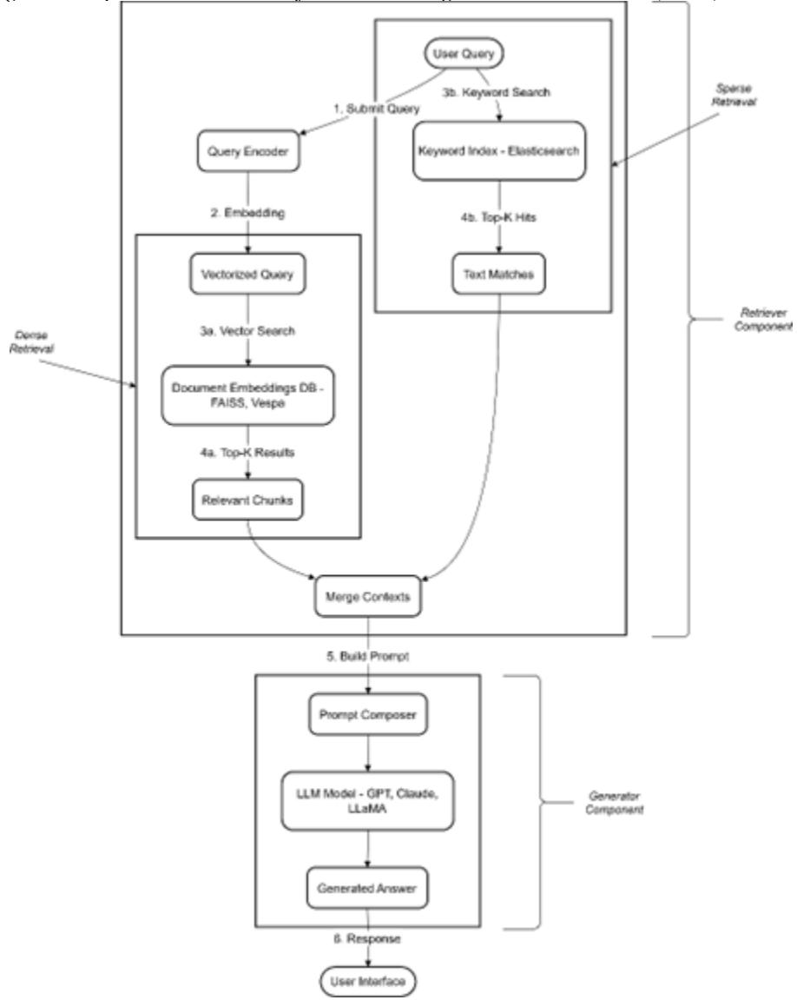
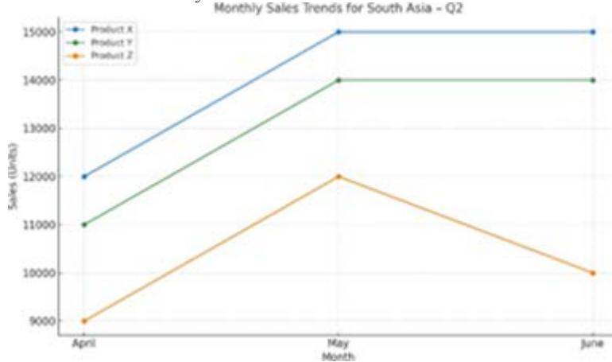
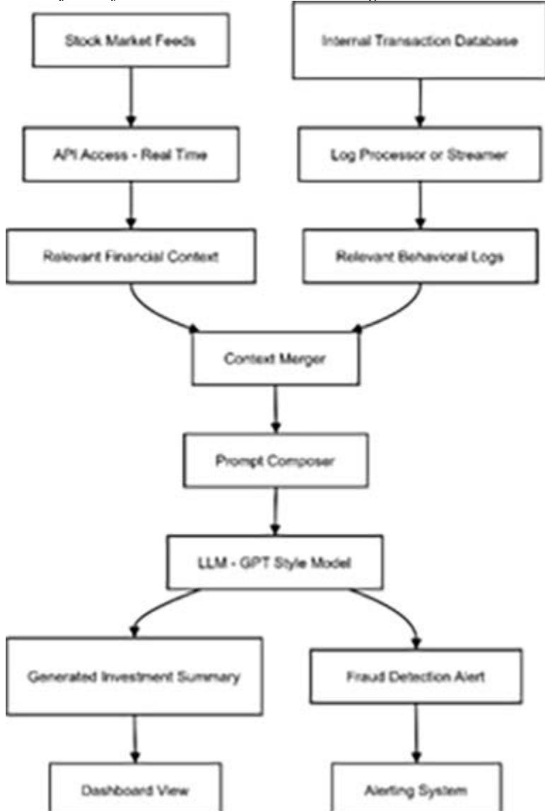
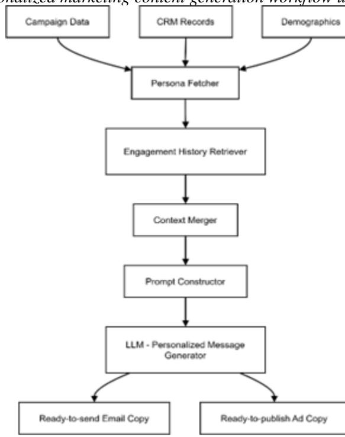
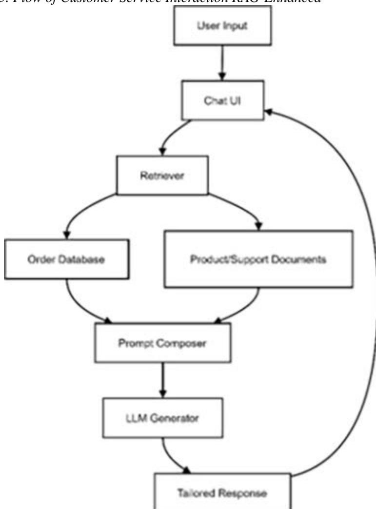
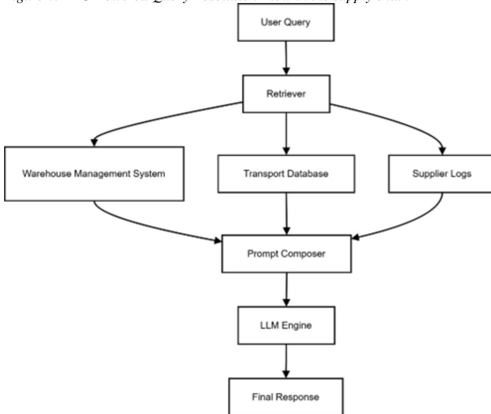
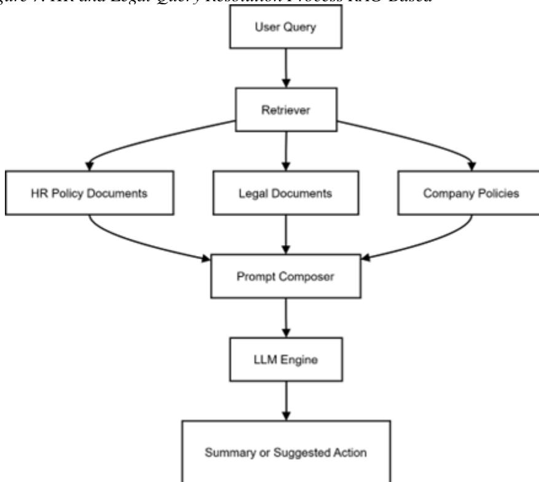
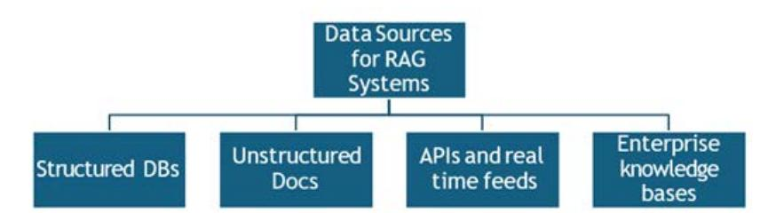
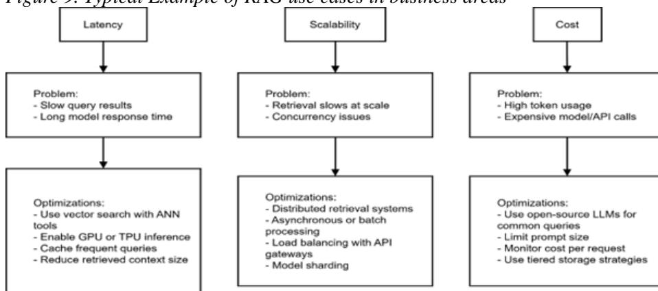
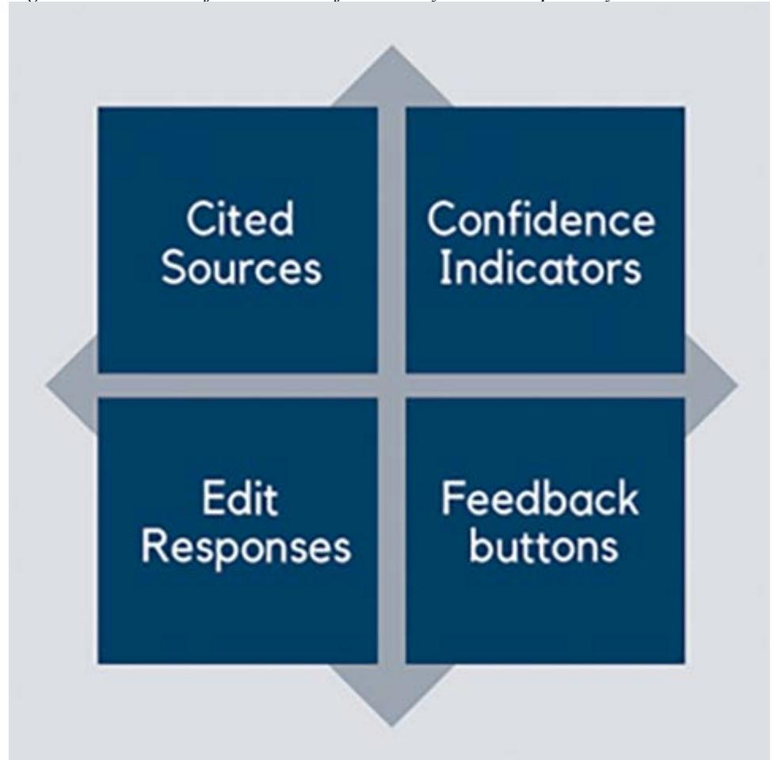

Copyright © 2026, IGI Global Scientific Publishing. Copying or distributing in print or electronic forms without written permission of IGI Global Scientific Publishing is prohibited. Use of this chapter to train generative artificial intelligence (AI) technologies is expressly prohibited. The publisher reserves all rights to license its use for generative AI training and machine learning model development.

# Chapter 3 Retrieval-Augmented Generation (RAG) for Enterprise Intelligence: Architectures, Applications, and Future Trends

**Shubhamkumar Pandit**

*Marwadi University, Rajkot, India*

### **R. N. Ravikumar**

 https://orcid.org/0009-0009-3705-1681 *Marwadi University, Rajkot, India*

## **Neeharika Joshi**

*Marwadi University, Rajkot, India*

**Sonukumar Pandit**

*Marwadi University, Rajkot, India*

**Satwik Kishore**

*Marwadi University, Rajkot, India*

### **S. Aarthi**

 https://orcid.org/0009-0006-9064-2091 *Marwadi University, Rajkot, India*

# **ABSTRACT**

*In today's data-driven world, traditional BI platforms fall short in providing realtime, context-aware insights. Large Language Models (LLMs) like GPT-3 and LLaMA excel in natural language tasks but struggle with outdated knowledge and hallucinations. Retrieval-Augmented Generation (RAG) bridges this gap by integrating LLMs with external data sources such as databases, APIs, or vector stores. This chapter explores RAG's architecture, combining retrievers (e.g., FAISS, Elasticsearch) with generators (e.g., GPT, Claude) and its enterprise applications in finance, marketing, HR, and supply chain. Key challenges like data governance, latency, and ethical considerations are discussed, offering a roadmap for deploying RAG to enhance real-time decision-making.*

DOI: 10.4018/979-8-3373-3912-2.ch003

## 1. INTRODUCTION

In this high-velocity, digitalized economy, organizations have to quickly determine the correct course of action using fast-changing volumes of data. Although Large Language Models (LLMs) such as GPT-3 and LLaMA have revolutionized the process of natural language processing, certain shortcomings, including its inability to adapt to changing business circumstances due to their inability to obtain access to business-specific data, hallucinations, and ability to only use static knowledge also negatively affect their practical utility. Retrieval-Augmented Generation (RAG) is an effective remedy as it unites generative capabilities of LLMs with real-time, context-sensitive information retrieval against both structured and unstructured endpoints. This chapter discusses the design, uses and advantages of RAG systems in business intelligence and decision support. RAG can be used to provide fact-based, explainable, scalable enterprise solutions, such as personalized marketing, real-time supply chain visibility and many more. It provides a revolutionizing twist in the way organizations access and make use of data and enables them with the timely and domain specific intelligence by empowering the decision-makers. Technical implementations, efficient deployment plans, and prospects of RAG in enterprise ecosystems are also described in the chapter.

### 1.1 Rise Of Data-Aware and Real-Time Enterprise Demands

Modern companies are more and more active in the conditions, where huge amounts of dynamic and continuous data exist. In this regard, there are three essential principles that the decision-making should follow in these contexts. One is that it must be timely based upon the current information that is available and up to date. Second, the choices made must be situation- based and never go against the organizational objectives, emerging customer needs and the external market environments. Third, decision making should be justifiable and decision makers can audit their actions, thus, making decisions based on the data attached to reliable and transparent sources (Arslan & Cruz, 2024). However, these needs are making the accustomed business intelligence (BI) systems hard to come up with these needs. Such legacy tools, usually based on static dashboards, scheduled batch reports and SQL-based queries carried out manually and manually, not only cannot handle the quick decision cycles common today, but also lead to serious consequences during the maintenance process. They are not responsive enough, to make informed and specific, real-time questions to unstudied, non-technical stakeholders, or provide responsive strategies in fluid situations.

Such shortcoming has made data-sensitive AI systems that intelligently read what is produced and transform it into the meaningful and timely information, with

an understanding of the natural language and knowledge of sources, that provide personalized and contextualized insights available at the right time and in real-time, an apparent and pressing need. RAG systems have developed as one of the solutions that make a lot of sense to this issue. These systems have a combination of LLMs and their ability to retrieve accurate data so that they provide a contextually relevant and factually accurate response (Emelia et al., n.d.). The path taken towards such systems is a tremendous development in the field of enterprise decision support. Businesses are placed in a situation where they require AI tools that can not only understand the context of an organization but also utilize new and reliable information in informing action, without yielding the accuracy and explainability. Such development indicates that the future is here where business-related insights powered by the AI become a common trend and an element integrated as part of the business process supporting fast, strategic, and decisive decision-making.

## 1.2 Retrieval-Augmented Generation (RAG)

RAG refers to an area of rapidly developing AI architecture, aiming to boost the potential of standalone LLMs by teaming them with complementary outside sources of information. RAG also differs with traditional models that generate responses guided by pre-trained internal parameters only (Chen et al., 2025). The initial level is the retriever, and this task retrieves relevant pieces of information on multiple external sources, e.g., vector databases (e.g., FAISS, Vespa) and keyword-based search engines (e.g., Elasticsearch), various databases (structured or unstructured) internal, and even real-time streams APIs. The second step involves a generator, which is most often a language model, such as GPT, LLaMA or Cohere, to automatically generate the retrieved data into a coherent, context-aware response (Khan et al., 2024).

Such design makes RAG-based systems such that they produce facts-based writings, which is much more likely to end hallucinations, as that way, it ties generation to something verifiable (Niu et al., 2024). What is more, RAG models can be calibrated with an enterprise-specific knowledge to provide a customized intelligence solution. Their outputs are also explainable and auditable which means they are particularly applicable to high stakes compliance-based environments. Steadily, RAG is thus a paradigm change in business intelligence and decision support- The means of delivering real-time, scalable, and reliable AI-driven analytics in present-day enterprises.

## 2. THE ARCHITECTURE OF RAG

RAG is an intermediate architecture that is built to improve on the weaknesses of standalone LLMs, by making them contextually grounded by incorporating an external source of knowledge. The innermost aspect of RAG is a split in the knowledge storage and the language generation processes allowing flexible access at run time to the appropriate data. This enables the outputs thus generated to be linguistically natural as well as factually correct and contextually contented to what the user intends.

### 2.1 Components: Retriever + Generator

RAG is an intermediate AI structure that supplements the shortcomings of independent LLMs, which entails a method of contextual grounding through the use of outside sources of knowledge. Fundamentally, RAG decouples the storage of the knowledge with the language generation process so that it is dynamic in the sense that given information can be accessed during run-time. This enables the outputs produced could not just be linguistically fluent but also factually accurate and contextually appropriate towards the intention of the user.

### 2.2 Typical pipeline: Query → Retrieve → Generate

**Retriever:** The retriever indicates the happiest fragments of data, that a big collection (e.g. in- house company files, structured databases, or indexed consumer responses) contains. It typically does so by using a dense representation (embeddings) of both the user query, as well as the documents and determining similarity between those representations. Retrieval Techniques:

- • Dense retrieval: Vector similarity (e.g. FAISS, Vespa)
- • Sparse retrieval: Keyword based search (e.g. Elasticsearch)
- • Retrieval range: It is possible to retrieve structured data (SQL-databases) as well as unstructured information (PDFs, emails, and reports and etc).
- • Top-k retrieval: It usually returns k most relevant results of the similarity scores.

**Generator:** The generator is a Large Language Model (LLM) that with query and the retrieved documents as inputs, is able to provide a rational, contextually explanatory answer.

- • Function: Makes a synthesis of the known knowledge retrieved and makes a total answer.
- • Models applied: GPT (OpenAI), Claude (Anthropic), LLaMA (Meta), Mistral, Cohere Command R, and so on. [8]
- • Input parameter: Query + Retrieved Context = Generated Answer
- • Positive: Limited hallucination, increased relevancy by basing creation on real facts which are retrieved.

*Figure 1. Pipeline Flowchart of Retrieval-Augmented Generation (RAG)*

The RAG scheme adopts a modular workflow pipeline Figure 1 matching between user intentions and applicable knowledge and translating them into useful smart output. It describes each of the stages in full detail, combining the dense (semantic) and sparse (keywords-based) retrieval strategies, and demonstrates them operating alongside a Large Language Model (LLM). To help drive this point home we use business example as follows: A territory sales person shares a query "What were

the top-selling products in South Asia in Q2?” into the enterprise RAG-powered dashboard.

#### Step 1: Submission of Queries

- • The user poses his or her question through a dashboard or conversational interface.
- • The query is then given to a query encoder, which is usually based on transformers (e.g. BERT or Sentence Transformers).
- • This encoder changes a plain text query into a dense vector - the numerical representation that reflects the piece of the semantic meaning of the question.

In our case:

The question under analysis is, “What were the top-selling products in South Asia in Q2?” is reinterpreted as a vector of intent (top product performance request) and context (regional and time specific constraints).

#### Step 2: Finding Information

### A. Dense Retrieval (Semantic matching)

The user query is initially converted to a vector form, and is indexed against a vector database, e.g.: FAISS, Vespa, etc. which has already computed the embeddings of enterprise documents, e.g.: sales reports, product reviews, and CRM (Han et al., 2024). This process enables the system to understand the query on the semantical level as opposed to being based on matching keywords. This causes the retriever to retrieve the Top-K most semantically nearby documents even in those cases where the documents themselves contain different keywords than the ones used on the query. This semantic search guarantees that context and meaning of the query is retained for further downstream generation of more precise and relevant information (Khan et al., 2024).

#### Example Output:

Internal quarter 2 sales report that reads: “The revenue of South Asia was up by 14% due to the growth of Product X and Product Y.” in the Figure 2

**Figure 2. South Asia Monthly Sales Trends 2**

## B. Sparse Search (Keyword Matching)

At the same time, the original query is also directed to such a sparse one as Elasticsearch. This module leverages the classic information retrieval methods such as BM25 or TF-IDF to find the documents having a full or partial matching of the keywords (Han et al., 2024)(Li et al., 2024). Compared to semantic search, the technique pays attention to lexical similarity and, therefore, could be used to locate documents where the sought-after terms are explicitly stated. Namely, when given the query of product catalogs or marketing summaries with keywords like Q2, South Asia, top-selling, and Product X, the system can give concise results that are based on textual matches. This will make sure strictly keyword like content will not be lost during the retrieval process (Khan et al., 2024).

## C. Context Converging

It then combines the results of the two the dense (semantic) and sparse (keyword) retrievers to achieve a balanced system with both an emphasis on the semantic relievancy of the user query and an emphasis on keyword matching as used in IR. This mixed retrieval technique makes retrieved information to be completer and more correct. In the process, redundant documents will be eliminated, and the context windows will be either cut or clipped to fit within the word limitations of the LLM. The step is essential as it is needed to optimize the length of the input and keep the most relevant and high-quality content that can be generated (Khan et al., 2024).

### Step 3: Prompt Construction and Generation

The combined and screened contextual data is formed into a well-rounded query that encompasses the actual user query along with the derived context i.e., derived sales data, product names, bullet points, and regional performance data. This orderly information is then forwarded to Large Language Model (LLM) such as GPT, Claude, or LLaMA, which uses it to come up with an expressive, situationally-aware, and enterprise-ready reply (Shao et al., 2023). As an illustration, one example of using a user query is as follows: what were the best-selling products in South Asia in Q2? The system enhances this query with corresponding retrieved information e.g.:

- • Product X and Y contributed to the South Asian 14 percent number growth in revenues.
- • In May, the performance of the product Z was good and it decreased in June.
- • The performance of the South Asia sales team represented 8 percent higher sales than the target was on a quarterly basis.

Upon command, this set makes the LLM produce a sensible answer such as:

In South Asia, the results during the Q2 were the most popular in terms of Product X and Product Y, where revenue went up by 14 percent. Product Z was good in the month of May and was down in the month of June. In general, the South Asian team has surpassed its share of the quarterly target by eight percent.” This case demonstrates how RAG could provide such business intelligence as unstructured data is converted into knowledge in action by means of structured contextual prompting and natural language generation.

### Step 4: Delivery of Response

The last leg of the RAG pipeline is the user interface, and here the sales manager/business stakeholder gets the AI insights in consumable mediums, on which he/she can act. The response can be in the form of:

- • Abridged sentence responses, giving accurate description of material in a short story form.
- • Visual display that can be in the form of charts, graphs, or dashboards that enables the user to keep trend and pattern easily.
- • Insight reports in downloadable formats (e.g. PDF or Excel) can be archived, shown in presentation or used in additional analysis.

This is immediate and multiple mode of delivering information that helps the manager make real-time decisions- shifting inventory in one region to another region based on its sales figures, the creation of executive briefs in record time or planning a product campaign that has a limited focus and meets the demand and growth of its market. The RAG system, therefore, connects the raw data about the enterprise and direct response-based action in the table 1.

*Table 1. Fundamental Elements of a Retrieval-Augmented Generation (RAG) System*

| Component       | Function                                   | Common Tools/Examples         |
|-----------------|--------------------------------------------|-------------------------------|
| Query Encoder   | Converts user query to embedding or tokens | Sentence-BERT, OpenAI         |
| Retriever       | Searches for relevant chunks/documents     | FAISS, Elasticsearch, Vespa   |
| Generator       | Uses context to produce a natural language |                               |
| Prompt Composer | Builds the final input for the LLM         | LangChain, Haystack Templates |

# **2.3 The RAG Pipeline Business Relevance**

Rather good business intelligence benefits come with the combination of retrieval and generation in this pipeline. First, it enables decision-makers to access data-supported reactions in real time without involving complicated technical knowledge and SQL proficiency. Second, it minimizes the reliance on data analysts or IT-based users to produce the periodic report since it will be on-demand and AI-powered. Third, this is an important aspect of the grounding of LLM outputs in verified, retrieved data, which decreases hallucinations and other factual errors, and makes one believe more in automatic responses. Lastly, System architecture is scalable and the enterprises can roll out this functionality to more departments, business units and geographies with significantly less reconfiguration (Niu et al., 2024) (Emelia et al., n.d.).

### **3. TOOLS AND FRAMEWORKS: LANGCHAIN, HAYSTACK, FAISS, VESPA**

In order to practically implement RAG states in businesses, scalable modular tools should be provided. There are a number of frameworks (both open source and commercial) that aim to support production quality RAG pipelines. LangChain, a Python library, allows creating multi-step applications that can easily work with

LLMs (Xu et al., 2024). It has prompts, retriever, database modules, and connects to vector stores such as FAISS and Pinecone. Another strong framework that can be used on both extractive and generative question answering is Haystack. It is compatible with models of OpenAI, Cohere, and Hugging Face and has features that allow logging and performance monitoring. FAISS (Facebook AI Similarity Search) is heavily tailored to searching dense vectors similarity, which allows ANN algorithms to scale to millions of vectors, creating high-quality retrieval results (Kim & Mahajan, 2025). Vespa is an enterprise-grade search engine, which also supports dense and sparse retrieval system and is at its best in high-performance systems such as large-scale recommendation systems. When these tools are combined, they provide the foundation of enterprise RAG systems, which are scalable RAG systems, responsive, and domain-specific AI solutions (Gan et al., 2025).

### **3.1 Advantages of RAG in Business Decision-Making**

With more and more enterprises using data-driven strategies, the capacity of retrieving, interpreting, and operating on information in real time will become necessary. RAG is an important step in the manner in which businesses interact with their knowledge and data systems. RAG, a combination of the LLMs and dynamic information retrieval, opens the doors to a wide range of possibilities in business intelligence and strategic decision-making.

### **3.2 Real-Time Data Access and Reasoning**

Traditional LLMs are not dynamic in nature since they are purely based on information that is pre-trained. This shortcoming causes slow response in business conditions that are changing at rapid rates. The above constraint is addressed by RAG, which can retrieve and update models with the most up-to-date and relevant enterprise data, during querying. Take the example of a financial analyst who wants to obtain the recent trend of revenue of Product X- Q2. Real-time data A RAG-enabled system can access live information as well, pulling actual sales data using live databases, business dashboards, or document repositories to inform the current or past few hours or days. This will make sure that the decisions will be determined by information relevant in the current business environment, and not row forecasts, or the old figures of the day before. In addition, RAG improves the multi-source reasoning- the models can refer and compare information between product documentation, regional performance, and historical trends. The ability to quickly interpret a message is especially important in the fields of finance and e- commerce, supply chains, and healthcare, where any hitch in the interpretation can cause big losses, or operational threats (Zhao et al., 2023)(Kostopoulos et al., 2024).

### 3.3 Factual Grounding and Reduced Hallucinations

Hallucination, that is, producing factually incorrect or fictitious material is one of the serious threats with standalone Large Language Models (LLMs) and therefore is a significant business risk. These errors may result in impaired decision making, mistrust among the stakeholders, and regulatory violations particularly in the industries where accuracy on information and subsequent traceability is important. RAG solves this problem by basing deliverables on validated enterprise particular data. In contrast with regular LLMs, RAG accesses facts that are taken directly trusted sources e.g. CRM logs, audit report or policy documents, which limits the risk of hallucination. Additionally, RAG guarantees traceability and auditability whereby response can be traced back to original documents which is very important in regulated sectors such as finance and healthcare sectors. As an example, a RAG system can even give evidence-based outcomes when asking why regional sales fell, e.g., supply chain delay or market saturation, instead of guesswork. Incorporating a solid factual basis and transparency, RAG produces trust in AI-created products and provides more trustful data-driven choices within the context of real-life business operations in the table 2.

*Table 2. Usage of Retrieval-Augmented Generation (RAG) in Business Functions*

| Business Function | What RAG Enables                                                                   |
|-------------------|------------------------------------------------------------------------------------|
| Finance           | Instant summaries of market activity, fraud detection, compliance draft generation |
| Supply Chain      | On-demand queries for logistics, warehouse, and inventory systems                  |
| Marketing         | Retrieval of persona data, campaign insights, customer behaviour summaries         |
| HR                | Dynamic policy reference, candidate evaluation, personalized onboarding            |
| Legal             | Accurate clause search, live regulation interpretation, contract comparison        |

### 3.4 Better User Interaction with Natural Language User Interface

Among the most groundbreaking benefits of Retrieval Augmented Generation (RAG) systems is the consideration that makes complex enterprise information simpler by means of, and in a natural tongue. RAG systems allow people to interact with data through a casual conversational language, unlike traditional business intelligence (BI) tools where one needs advanced skills in writing SQL queries or cooking their way on occasion complex dashboards. This drastically reduces the data-driven skill threshold of the non-technical staff at every level of the organiza-

tion including managers, human resource specialists, customer service managers and marketing analysts. As an example, a human resource head can ask the question, what is our staff turnover trend in the first quarter of the year, by department or a customer support head may ask, give me the number of customer complaints related to late delivery over the past 30 days. In the two scenarios, RAG returns the most topical and up-to-date documents/datasets before converting them into a compact and precise answer (Arslan & Cruz, 2024). The fact that the user may ask the business-related questions in their own words in a RAG system makes it more accessible, fosters the use of AI throughout the enterprise by removing the training overhead that is often required to use analytics tools. This leads to the more efficient operations and data literacy, and accelerated decision response time in everyday decisions in the table 3.

*Table 3. Business Benefits of Retrieval-Augmented Generation (RAG)*

| Advantage                    | Business Value                                                             |
|------------------------------|----------------------------------------------------------------------------|
| Real-Time Data Access        | Enables fast, informed decision-making based on the latest enterprise data |
| Factual Grounding            | Reduces hallucinations, improves trust in LLM responses                    |
| Domain-Specific Adaptability | Aligns AI responses with industry- and company-specific knowledge          |
| Natural Language Access      | Empowers non-technical users with intuitive, conversational interfaces     |

## 4. BUSINESS APPLICATIONS OF RAG

The Retrieval-Augmented Generation (RAG) systems are very flexible and may be adjusted to any great percentage of business needs. With powerful state-interpolated language models coupled to the latest, multitemporal data retrieval, RAG supports enterprises to automate decision-making, personalize communication, and increase department-wide operational intelligence.

### 4.1 Finance: Market Reports, Fraud Alerts, Investment Summaries

RAG allows real-time intelligence to be created dynamically instead of viewing stagnant analytics dashboards and historical business intelligence pipelines that are present in fluctuating financial services (Krause, 2023). RAG systems can also make financial professionals more responsive and data-driven in their decisions by interacting with enterprise data in natural language because it can accept live data feeds like stock market APIs, financial news, and the internal transaction records

(Wang et al., 2025). The below Figure 3 illustrates a RAG-enabled financial intelligence pipeline where real-time data from stock feeds and transactions is merged, processed via a GPT-style LLM, and used to generate investment summaries and fraud alerts for dashboards and alerting systems.

*Figure 3. Workflow of RAG-Driven Financial Intelligence and Fraud Detection*

The RAG systems provide revolutionary potentials in the financial sphere as they also provide real-time and intelligent analysis. Instantaneous market summarization the important usage is an on-demand market summarization, in which RAG creates a live summary of stock prices and financial news based on an investor portfolio (Krause, 2023). Another important application is the fraud detection warnings, which have the system constantly review transaction records to detect unusual patterns, anomalous or criminal habits, and activate immediate alerts to aid in the regulatory compliance and managing the risk. Also, RAG enables personalized investment analysis whereby an investor will query the trends in the performance, assets, and summaries on time. The insights are generated on a real-time basis, and their decisions on portfolio optimization are data-driven and timely (Wang et al., 2025).

The RAG pipeline, in return, will access the portfolio data of the user, compare the current performance to the historical trends, and provide a risk-conscious report that is personalized and finished within several seconds. An example of such intelligent pipeline is presented in Figure 3 that shows samples of the working process in a financial intelligence program powered by RAG. The figure highlights the process through which real-time data streams are consumed and processed using a retriever and a generator and then returned in form of useful actionable insights as a response to the query that was presented by the user. This end-to-end procedure is the bright example of how RAG manages to transfer financial analysis to the agile interactive and reliable support system.

## **4.2 Marketing: Personalized Campaign Generation**

On incorporation of RAG into the marketing processes, it enables organizations to create hyper-personalized textual content using user engagement, campaign history, and customer segmentation insights. RAG, unlike other traditional rule- based systems has the ability to dynamically access and restructure pertinent data across any enterprise system (ex: CRM databases, A/B testing results, and demographic analytics) to generate marketing content that is not only contextually accurate, but specific to the target audience. The below Figure 4 illustrates a RAG-powered personalized marketing workflow, where campaign data, CRM records, and demographics are merged to generate engagement-aware email and ad copy through an LLM-driven message generator.

*Figure 4. Personalized marketing content generation workflow using RAG*

RAG will then extract the pertinent CRM records, records the success rates on the marketing campaign when it comes to that demographic group and then creates a tailored marketing email that will be captivating and tailored. It shows the graph of this smartly developed content creation pipeline, and the personalized marketing process, driven by RAG. It also illumines the way in which input request are carried out by using retrieval and generation stages with the help of the enterprise knowledge to provide relevant timely and conversions directed message. With these implementations, not only does a business increase levels of engagement, but it also maximizes its marketing ROI via parts and personalization.

### **4.3 Customer Service: Context-Aware Chatbot Responses**

RAG is a new generation of chatbots and is revolutionizing customer service with contextual, personalized and live assistance. In contrast to traditional bots which are limited by limited, rule-based answers, RAG-enhanced systems could dynami-

cally retrieve most recent support tickets, product manuals, FAQs, and, best of all, individual customer history to learn the most precise and understanding answers.

*Figure 5. Flow of Customer Service Interaction RAG-Enhanced*

The Figure 5 shows Flow of Customer service interaction RAG-Enhanced displays that the user query passes through a two-step retrieval and generation pipeline that draws data (customer-specific and policy-related) and constructs a logical and actionable response. This results through improved resolution times as well as a

decreased agent workload and a more personalized customer experience which fuels greater satisfaction and loyalty.

## 4.4 Supply Chain: Real-Time Inventory and Logistics Q&A

Amidst the world of supply chain management, where time and accuracy is of essence, the RAG systems promise a revolutionary means of managing natural language queries. Manual files are frequently extracted by using traditional systems, which are isolated audit data and logistics dashboards or supplier portals in a warehouse. Quite conversely, RAG systems accelerate this process by linking with these backend engines and providing quick, context specific responses in real time (Gaddala & Sharma Gaddala, 2023). The below Figure 6 This diagram represents a RAG-based supply chain query resolution system where a user query is processed through retrieval from warehouse, transport, and supplier data sources, synthesized by a prompt composer, and answered via an LLM to deliver a final, actionable response.

*Figure 6. RAG-Powered Query Resolution Flow in the supply chain*

Once a query such as; How many units of Product Z do we have on stock currently in Mumbai and when is the next batch arriving has been keyed in the RAG system goes into a multi-stage process. It retrieves live inventory information on the Warehouse Management System (WMS), queries delivery and logistical services (e.g. ERP or SCM APIs) and consolidates the information to produce a human-readable response. The answer may be: Product Z quantity in Mumbai warehouse is 320 units. The other one will come on June 22 by Supplier A. The ability saves time as well but more importantly avoids human error so that decision-makers are able to take some immediate actions. An example has been noted where the stocks are low and there is no shipment that is expected to be received in days to come; the insights that can be made known by the system may prompt an immediate decision of procurement, which may avoid the disruptions.

Examples of where RAG will be an applicable strategy in the supply chain include:

- • Giving stock-availability in real-time in various warehouses.
- • Reporting delay in delivery, distributes or customs assessments.
- • corps production of supplier performance summaries and identification of possible risks.

The workflow of the system will be incorporated effectively with the APIs and operational databases so that the responses given by the system will be precise and timely as is shown in RAG-Powered Query Resolution Flow in the Supply Chain (Wu et al., 2025). Such an architecture can add considerable value in terms of efficiency, responsiveness, operational intelligence throughout the supply-chain enterprise (Gaddala & Sharma Gaddala, 2023).

## **5. HR AND LEGAL: POLICY GENERATION, COMPLIANCE SUMMARIES**

Human Resources and Legal teams regularly have too much documentation to process, e.g. policy manual, regulatory requirements, compliance requirements, contracts and internal processes. Browsing and interpreting this information manually is cumbersome not only because it is time consuming but also subjected to missing out. To counter this, Retrieval- Augmented Generation (RAG) systems solve this problem by ensuring that such material is searchable, readable and actionable via simple natural language queries, on-demand contextual answers.

*Figure 7. HR and Legal Query Resolution Process RAG-Based*

The above Figure 7 represents a RAG-based supply chain query resolution system where a user query is processed through retrieval from warehouse, transport, and supplier data sources, synthesized by a prompt composer, and answered via an LLM to deliver a final, actionable response. These types of systems can effectively address both HR and legal inquiries by accessing both structured and unstructured enterprise data resources as indicated in HR and Legal Query Resolution Process RAG-Based. On the HR side, some of the common use cases are summarizing a policy on leave, benefits or onboarding, outputting a job description or internal communications, and answering contextual questions like, what is our policy on remote working on contract employees?

Legally, RAG can be applied to extract and interpret the provisions of regulatory documents or contracts, author compliance reports and even monitor any change of policy over time. To give an example, when the question is presented, such as: Provide an overview of the key changes to our policy of data privacy since the last quarter, the RAG system would retrieve potentially relevant documents out of the repository of the policies, use vector-based similarity (semantic diff) to compare the

current and previous policy versions, and generate a clear answer, like: In the policy update of the previous quarter, the terms of employee consent have been extended and control on data sharing with third-parties is added (Li, 2024). This kind of functionality significantly enhances the effectiveness, precision, and appurtenance of HR and legal operations so that an organization can answer timely to any internal requests, be compliant, and make wise decisions having verified contents to support them all. The table 5 as follows.

*Table 5. Real-world Applications of Retrieval-Augmented Generation (RAG) the business functions*

| Domain       | Application                             | Example Query                              |
|--------------|-----------------------------------------|--------------------------------------------|
| Finance      | Risk summary, investment reports        | “Summarize top 3 market risks this         |
| Marketing    | Campaign optimization, customer persona |                                            |
| Supply Chain | Inventory tracking, logistics Q&A       | “Where are delays occurring this           |
| HR & Legal   | Policy insights, compliance checks      | “What are leave policy changes post-2023?” |

# **5.1 Data Sources and Index Management**

A working RAG system has its basis by ensuring that reliable and pertinent information is extracted out of enterprise data stores. They may include:

*Figure 8. Data Sources for Retrieval-Augmented Generation (RAG) Systems*

- a. Structured databases (PostgreSQL, Snowflake, Big Query)
- b. Unstructured documents (PDFs, word files, email, internal reports)

- c. APIs and real time feeds (ERP, CRM, IoT systems)
- d. Enterprise knowledge bases (on Confluence, Notion, SharePoint)

The Figure 8 categorizes the primary data sources for RAG systems into four types: Structured Databases, Unstructured Documents, APIs and Real-Time Feeds, and Enterprise Knowledge Bases each contributing essential context for generating accurate, data-grounded responses. Preprocessing of information and structuring is a technique that is needed to make sure that efficient and accurate retrieval can be done in a RAG system. The initial process is to divide raw data into semantically rich segments, paragraphs, sections or tables and so on, depending on the type and scenario of the document. This contributes towards logical consistency and retrievability. These text blocks are segmented, and then they are fed into complex embedding models, and the most common are Sentence-BERT or OpenAI Embeddings to get the vector representation (Kim & Mahajan, 2025). The semantic meaning of such texts, as defined by these embeddings, is then stored and indexed efficiently by utilizing such tools as FAISS, Vespa, or We aviate, which are optimized to efficiently and consistently retrieve similarity search in large collections.

Also, in the case of an environment where there is a constant shift in the data the utilization of automated daily indexing and synchronization pipelines is imperative, e.g., sales reports or HR regulations (Macdonald et al., 2025). The processes make sure that the state of the vector database is not outdated and always has the newest content thereof, thus keeping the responses generated accurate. One such best practice in the implementation of RAG is the parallel use of dense indexing (in support of semantic search) and sparse indexing (in support of precision in keyword search). The hybrid method goes even further, being able to provide the system with results that are not only contextual but also match certain terms within the query presented by the user, thereby improving the memory and the amount of precision with information finding.

## **5.2 Retrieval Precision and Ranking Strategies**

Quality of retrieval has direct bearing on the output reliability in a RAG system. Irrelevant or outdated results could also be retrieved which would turn even the well-formed responses containing error. Ranking techniques such as similarity (cosine) or BM25 should be used to put on the top the documents more likely to be interesting. Reduce the search space using filters and metadata tags (e.g., department, time frame) and rewritten queries was used to improve short or vague queries. To make the precision more accurate, apply multi-stage retrieval pipeline: the initial stage retrieves broadly relevant documents by performing a vector search, and the second stage re- ranks them by employing task-specific models such as BERT-based

cross encoders. This will cause only the most relevant content to reach the LLM, making responses of higher quality in general.

### 5.3 Latency, Scalability, and Cost Optimization

As RAG systems are dependent on a number of stages, retrieval, prompt building, and generation, the response latency may be an issue (particularly where real-time response is required, such as chatbots or decision dashboards) (Kim & Mahajan, 2025). The below Figure 9 outlines key challenges faced by RAG systems latency, scalability, and cost and presents targeted optimizations for each. It highlights solutions such as ANN-based vector search, distributed retrieval, and the use of open-source LLMs to enhance performance and efficiency.

*Figure 9. Typical Example of RAG use cases in business areas*

Enterprises that want to reduce latency in their RAG systems should implement low-latency vector databases with approximate nearest neighbor (ANN) search, perform LLM inference at low-latency GPUs or APIs such as OpenAI or vLLM and cache common queries and answers. To scale horizontally and vertically, to allow retrievers and generators to be containerized and to support high throughput with non-blocking async responses, microservices can be considered. Size reduction can be achieved by local optimization using reduction/condensing of records and there can be several tiers of embeddings (summary and detailed) that can be saved. In house deployment of open-source LLMs such as LLaMA can also reduce API cost.

## 5.4 Performance Measuring and Evaluation

After implementation, evaluation of RAG systems should be conducted continuously with the help of quantitative indicators and qualitative feedbacks. This is done by monitoring the performance; this keeps retrieval and generation precise, quick, and current to business performance.

However, Key Evaluation Metrics are planned as follows:

1. a. Top- k Accuracy (Hit Rate): Indicates the top k retrieved documents in order to determine whether the correct document is retrieved (Maksim, 2024).

$$\begin{aligned} \text{Top} - k \text{ Accuracy} &= \\ \text{Number of correct queries with relevant document in top} - k & \\ \text{Total number of queries} & \end{aligned}$$

1. b. Precision@ K: Proportion of the retrieved documents by the top K which are relevant (Maksim, 2024).

$$\begin{aligned} \text{Precision@} K &= \\ \text{Number of relevant documents in Top} - K & \\ K & \end{aligned}$$

1. c. Mean Reciprocal Rank (MRR): Measures the quality of ranking through the average of the reciprocal rank of the first relevant document (Maksim, 2024).

$$MRR = N \frac{1}{\sum N_i} = \frac{1}{\sum \text{rank}_i}$$

Where *ranki* denotes the rank of the first relevant document retrieved for the *i*th query.

1. d. Latency (Time per Query): The grand total time of user query processing including retrieval through generation.
2. e. The Score of user feedback was: Summarized Thumbs-up/Downs or Likelert rating by user on an output.

Determined decline in MRR or Top-k Accuracy will possibly be evidence of index drift or inadequate chunking of documents.

## 6. TEMPLATING TACTICS AND PROMPT ENGINEERING

Although the responsiveness of documents retrieval may be right, the overall performance of any RAG system can only rely on good prompt formulation. Prompt engineering is a practice of creating a scaffolded template that nudges the Large Language Model (LLM) with regards to tone, scope, and reasoning. A number of methods augment this: template prompts are pre-programmed messages on frequent tasks such as summaries or reports; chain-of-thought prompts train the model to describe its reasoning step-by-step; and role-based instructions assign a particular role (e.g., Act as a financial analyst) to render responses in the desired manner; and metadata-based prompts implement metadata such as titles or timestamps to clarify context. Designed prompts do not only lower the number of hallucinations but augment specificity of the domains and clarity of response (Krause, 2023).

### 6.1 Preprocessing and Chunking of Documents

Successful RAG systems rely on the quality of division of source documents into meaningful chunks in order to embed. What constitutes best practices in chunking is the optimal 200-500 token size of the chunk and a sliding window approach to enable 20-50 percent contextual overlap between the previous and the next chunk. Arbitrary divisions are undesirable but NLP can be used to guide semantic splitting according to headings, punctuation marks, or any other section titles. Preprocessing is also significant-this includes eliminating the header, footer, and the boilerplate text, use of OCR on a scanned image, and maintenance of important business entities made by means of Named/Entity Recognition (NER). Properly engineered, eliminating-noise chunks are much more accurate in retrieving and lead to more consistent and contextually relevant LLM outputs.

### 6.2 Logging, Monitoring and Observability

RAG systems to be reliable, auditable, and easily debug gable, robust observability in production is essential. Key elements to log include user queries, retrieved documents, LLM responses, source identifiers, confidence scores, embedding versions, latency, token usage, and failure reasons. Monitoring tools play a critical role: Grafana and Prometheus help track latency, error rates, and API performance; Open Telemetry supports distributed tracing across LLMs, retrievers, and databases; and the ELK Stack (Elasticsearch, Logstash, Kibana) enables efficient log storage, search, and visualization. These logs are vital for auditing, troubleshooting, and tracing the exact data sources used in decision-making, ensuring transparency and accountability.

### **6.3 Feedback Loop and Integration at the User Experiences (UX) Level**

No matter how well designed a RAG model is, it is not guaranteed to work, especially when the end-users do not trust the results of the report or simply cannot understand it. User-friendly interface, the visibility of sources, and sensitive feedback lines are important (Chen et al., 2025). The below Figure 10 highlights key UI elements cited sources, confidence indicators, editable responses, and feedback buttons that enhance user trust, explainability, and interaction quality in RAGpowered applications. UX To Include Features:

*Figure 10. User Interface Features for RAG System Transparency and Feedback*

User-friendly interface is a critical success factor of RAG systems and introducing interactive elements to the interface should improve usability and overall system polishing. The most important UX features are cited sources as they show names of documents, links, and timestamps with corresponding response; confidence indicators, which reflect the trustworthiness of answers using scores or color codes; editable responses, where a user can edit or re-render the same information in a different context; and feedback buttons such as Helpful or Not Helpful with an ability to add optional commentary (Roychowdhury et al., 2024). The feedback loops are important to improve system because it improves prompt templates, advances retrieval or chunking strategies, and determines frequently asked questions to cover them better. To give an example, when the user will give out a response as unhelpful and choose the explanation like: “Outdated Info” or “Wrong Source,” the system will adjust itself accordingly and over time will be able to learn and perform better continuously.

## **7. SECURITY, PRIVACY, AND ETHICAL ISSUES**

Since companies are implementing RAG systems to communicate with sensitive internal information, it is urgent to examine the issues of data protection, clarity, regulatory compliance, and ethical AI. The RAG systems Unlike the traditional language models-RAG systems touch the real business documents-creating new vectors of risk unless handled properly. This segment describes the fundamental areas that organizations have to put into consideration so as to maintain the RAG implementations as reliable and as lawful.

### **7.1 Data Sensitivity and Access Control**

RAG systems frequently access confidential business information, such as employee records, legal agreements, customer profiles or financial statements (Joshi, n.d.). Without the right number of limitations, the user might end up reading sensitive material not meant to him or her, worse still an LLM in such case can hallucinate access to confidential data in case such data has found its way into a retrievable source (Fleischer et al., 2024). As countermeasures against security and privacy threats in RAG systems, the organizations need to install multi-layered access controls at data retrieving and user interaction levels. RBAC is also necessary, as it will guarantee limited access to certain categories of data by such users as the HR department or the financial team. On top of that, document-level authorization ought to then categorize content according to level of confidentiality or business unit, and so on the access is further limited. Additional layer of protection is provided by secure

authentication in enterprise identity systems like OAuth2, Single Sign-On (SSO) or LDAP. e.g., customer service agent is not supposed to suspect legal contracts except they are allowed to do so. Such controls guarantee availability of sensitive information to only those privileged to do so, and keep the enterprise data in line with the regulations and internal policies.

## **7.2 Auditability and Explainability in RAG Pipelines**

The success of AI systems greatly depends on trust among their users, which is related to transparency, particularly toward the more controlled fields of finance, healthcare, and legal services. In contrast to conventional black-boxes LLMs, RAG systems have better traceability, by revealing which specific documents each response is based on. Central actions of retrieving logs to record what documents were accessed by whom and when, citing the sources in responses to show document names, timestamps, or other metadata, and offering retrieval confidence scores to reflect reliability of the information, are among the key ones. This explainability is important to internal audits, regulatory compliance, user trust especially when AI decisions have any bearing on the generation of a vital decision on hiring a person, making an investment, or deciphering a law (Kostopoulos et al., 2024).

## **7.3 Regulatory Compliance (e.g., GDPR, HIPAA)**

Where RAG systems are dealing with individual or controlled information, the local and international data protection legislation must be considered vital, in order to prevent any legal charges as well as maintain consumer/user assurance of privacy. Other important regulations are GDPR (EU) with requirements of the right to be forgotten, processing data based on consent and auditability; HIPAA (US) with its requirements to protections of health data through encryption and audit trail; and DPDP Act of India that enforces purpose limitation and user consent on processing of personal data. The actions to be taken, through which adherence may be assured, include data masking or anonymization of personal identifiers, geo-specific deployment models (such as deployment of GDPR-compliant systems in the EU), and extensive data access, processing and retention logs. Moreover, RAG systems must have processes that require the consent of the user prior to operating information, which is identifiable. An example of how a GDPR system would store mission-critical data about its users is that the retriever database would not include or pseudonymize the identity fields to maintain the privacy of individuals within the legal limits of the GDPR (Maddali, 2024).

## 7.4 Biasness, Equity and Liable Output Production

Although using factual sources, RAG-based responses may have biases that are present in society or dataset-levels, especially when the retriever gives access to archaic or prejudiced papers. This becomes a big threat in areas that matter like in HR, finance or in the policy area where AI-based decisions may have direct impact on individuals. To alleviate these kinds of problems organizations will have to embrace ideas of Responsible AI. These steps include creating balanced and diverse corpora to train and search through as well as performing an audit on them regularly to identify possible patterns of prejudice or hurtful language and using post-editing filters to weed out stereotyping, hate, or exclusionary terms and phrases (Emelia et al., n.d.). Also, the incorporation of human in loop processes makes sure that AI is assistive and will not substitute human judgment when making critical decisions. As an example, when developing a profiling system to select candidates, it should not reproduce historical discrimination by advancing and discriminating against a certain group of people. These would contribute to ensuring fairness accountability, and ethical integrity within RAG enabled enterprise systems.

## 8. FUTURE TRENDS AND OPPORTUNITIES

The liability of RAG systems is rapidly developing to the next generation as businesses proceed to implement intelligence and decision support on the existence of RAG support. These systems are no longer being simple text-based Q&A, but are becoming dynamic, multi modal and adaptive. These areas of future development will indicate six of the most essential future directions that will define how enterprises will use RAG in the upcoming years.

### 8.1 Multimodal RAG (text + image + video)

The RAG systems that have been in prominence allow only textual documents to be used and therefore cannot cater to rich information, visual or auditory information that exists within enterprise knowledge (Mei et al., 2025). Nevertheless, valuable data in the digital enterprise context are not just in format as PDFs or policy document, the data could also be in images of products, recorded meetings, infographics, scanned forms, training videos and so forth. To fill that gap, multimodal RAG tries to combine all these modalities, the text, the image, the audio and the video, in one coherent retrieval and generation pipeline. (Chen et al., 2022)Within a multimodal RAG structure, the embeddings produced are based on both text and visual or acoustical information which enables the retriever to bring up the most pertinent content

without mattering on the structure (Mei et al., 2025). Then the LLM can combine responses that take into consideration several kinds of context (Zhao et al., 2023).

Multimodal RAG systems have great values in that they go beyond the text to include other types of data which are images, diagrams and multimedia information. A major advantage is that of cross-modal perception to allow generation of response given visual data such as annotated diagrams or product catalogs based on an image. This significantly increases coverage of knowledge, as the system is able to access and provide meaning on valuable information which is not textual and in other formats, otherwise, unable to be utilized in conventional RAG pipelines. In addition, the accessibility is enhanced because it is now possible to respond based on a larger pool of documentation, such as scanned forms, infographics, and videos, which makes the system more accommodative and sensible to different business use cases.

## **8.2 Integration with Business Knowledge Graphs**

Although conventional RAG systems conduct semantic search in flat document databases, with the addition of business knowledge graphs, they offer a more structured overlay that can better understand and interpret context, precision and reasoning. A knowledge graph is an entity and relationship model whose entities (e.g., customers, suppliers, departments) and relationship (e.g., orders) reflect the business logic and structure of an organization (Zhu et al., 2025). Integrating RAG and knowledge graphs with the retriever enables it to filter or pre-sort search with regard to semantic relations. This information can then be used by the generator in a manner that enables the generation of responses that are contextually correct and are relevant with the internal logic of the organization. Knowledge graphs have extremely effective benefits with respect to enterprise applications when they are integrated into RAG systems. To begin with, it facilitates fact checking and constraint-based querying of the responses made on fact based, verified relationships. This will particularly come in handy where data accuracy is important in the regulated industries. Second, it enables more efficient processing of complex queries across the enterprise, especially queries over hierarchies, or related data elements e.g. organizational charts, or data dependencies in a supply chain. Finally, knowledge graphs increase explainability through visual and semantic representation of the relationship of entities involved in production of a response. This not only will make this more transparent but also generate trust in the decision-making process of the AI.

## **8.3 Self-Improving Enterprise Assistants with Continuous Learning**

The further development of RAG systems will be along adaptive and self-improving assistants that learn through the history of interaction, feedbacks by users, and continuous changes in the data (Shukla, n.d.). Instead of remaining fixed tools, these assistants will develop as time goes by to meet the expectations of the user and enterprise objectives better (Asai et al., 2023). Through these systems, users will interact with responses and see their beliefs and uncertainties in their interaction, using their frustrations to adjust ranking or prompt, or generative behavior. They are also able to survey the documents that are most accessed and update the embeddings when new information is entered. Its main highlights are optimization of queries depending on previous activity and feedback, dynamic prompt optimization with the focus on relevance and tone. Moreover, the re-indexation and document refresh is applied to continuously ensure that responses are kept up to date with the most up-to-date environment.

## **9. RAG + TASK EXECUTABLE AGENTS (AUTONOMOUS)**

Although RAG is good at responding to questions, making it behave on information would be the next step. RAG systems, combined with AI agents, are able to drive workflows, schedule tasks or communicate with people creating automated action out of insights (Roychowdhury et al., 2024). RAG can act as memory or context provider to autonomous agents such as those created with LangChain Agents, AutoGen, or CrewAI. The agent, based on the documents retrieved, takes informed actions of drafting a message, updating a record, or calling an API. The RAG systems augmented with self-administered task fulfillment agents develop to become active (and eventually active) digital assistants who can perform real business logics.

These systems are able to prepare and send performance summaries to departmental heads, automatically initiate recommended orders of the supply chain in case of critical shortage of stocks and intelligently propose useful insights by analyzing meeting notes or reports. To use a real example, a RAG-enabled finance assistant can access monthly expense reports and policy documents, make a compliant email proposal to the CFO related to changes in the budget, and add relevant summaries, all without the influence of a human being. This transition is a major upgrade in automation of enterprise, and can result in intelligent, situationally aware action.

## 9.1 Streaming Data Real-Time RAG Integration

Static document repositories are a common feature used by traditional RAG pipelines but are not applicable to modern enterprise-paced business such as financial environments, logistics, and operations based on IoTs. The gaps addressed by real-time RAG integration with live streams of data (e.g., Kafka, AWS Kinesis, MQTT), and make intelligence dynamic and event based. Such ability enables the organization to instantly respond to the emerging situations. The application in the real world includes providing customer support in real-time, tracking movement of goods and services using GPS and traffic API as well as detecting fraud based on transactional anomalies. As another example, a logistic manager who wants to know about late deliveries gets an insight in real-time, supported by real time sensors on the ground, and delivery history, timelines and trends. Such responsiveness necessitates the use of high-performance retrieval engines such as Vespa and low latency LLMs with short efficient prompts. (Gan et al., 2025)

## 9.2 Privacy-Preserving and Federated RAG

An increase in data privacy laws including GDPR, HIPAA, and the DPDP Act in India continuously restricts the possibility to centralize enterprise data (Li, 2024). Federated RAG enables enterprises to query data on many secure sources without any copying or centralization. With this arrangement, every department or region will have its own retriever and index whereas one central LLM index will query each one separately as well as generate the eventual result (Macdonald et al., 2025). The architecture secures sensitive information, allows compliance, and honors data sovereignty. A privacy-preserving solution, which places retrieval nodes on the remote site runs on the Federated RAG systems and makes data on a local index to keep data in a regional scope, so it is not transmitted outside the region. Important features are implementation of local retrieval infrastructure, introduce privacy-preserving techniques that will protect the identity of the users, and use encryption on the queries as well as document transfer. As an example, an international business that has customers in the EU and APAC will be able to run the customer satisfaction queries by region and produce no more than generalized information without exporting the raw data to other jurisdictions. This strategy will help to comply with data protection laws such as GDPR, HIPAA, etc., and thus will help the company serve industries dealing with data (medicine, finance, law, and others) where central storage of data can be a legal and business liability and the table 6 as follows.

*Table 6. Retrieval-Augmented Generation Future Improvements of Enterprise Applications*

| Trend                       | Capability Added                    | Tool or Technique                        |
|-----------------------------|-------------------------------------|------------------------------------------|
| Multimodal RAG              | Handles images, videos, PDFs        | CLIP, Donut, LayoutLM                    |
| Knowledge Graph Integration | Relationship-aware search & prompts | Neo4j, RDF, SPARQL                       |
| Self-learning Assistants    | Learns from feedback and logs       | LangChain Agents, Reinforcement Learning |
| Real-time Streaming RAG     | Uses live data feeds                | Kafka, AWS Kinesis, Vespa with API layer |

## 10. CONCLUSION

Retrieval-Augmented Generation (RAG) is a paradigm-changing method in the field of business intelligence and decision support as it is possible to create competitive advantages in an era of timely, accurate and situation-appropriate insight. Conventionally, language models (LLMs) are tremendously amazing when it comes to generation but lacking dynamic knowledge, dangerous to hallucination and can only access business proprietary data when it

is already in the market. These shortcomings are directly solved by RAG which integrates the fresh language fluency of LLMs with factual accuracy and current context of dynamic retrieval methods. Based on the chapter, we learned about the technical structure of RAG systems, which is broken down into retrievers, generators, and orchestrating frameworks such as LangChain and Haystack and illustrated that they combine in a typical pipeline of: RAG systems can supply a founded output whose verisimilitude in business can be traced by accessing related chunks in structured databases, unstructured documents, APIs, or other vector search engines.

RAG is most applicable in business terms including real time financial reporting, individualized marketing, supply chain diagnostics and HR/legal compliance. Such systems do not only automate what has been manual before but also provide instant, personalized, and explainable information to decision-makers. In addition, the fine-tuning potential of RAG enables organizations to incorporate company-specific jargon, processes, and compliance- related logic into its AI system, turning it scalable, highly customized to in-house objectives, and deeply integrated with company dynamics. A variety of practical concerns should be taken into account to use RAG successfully in data preprocessing and chunking, prompt engineering, retrieval performance, latency, cost optimization, observability, user experience. As

it was emphasized, security, ethical compliance, and privacy (e.g., GDPR, HIPAA, DPDP) should be an essential part of any enterprise-level RAG system development.

Looking into the future, RAG is ready to develop even more. The future trends are multimodal integration (text + image + video), increase in the knowledge graph, real time streaming support, Federated deployment with privacy-preserving intelligence application, and adaptive assistants that learn over time. Such innovations are a promise of a future where RAG systems not only inform decisions, but also make them, explain them and learn their consequences. To sum up, the Retrieval-Augmented Generation is not only a technical improvement but a strategic tool of contemporary business. As an intermediary between the generative intelligence and real-life business information, RAG enables organizations to make smarter, faster and more transparent decisions. Thus, it is the future of AI-enabled business change with a viable and futuristic basis of businesses to prosper in a data-intensive fast-paced business environment.

# **REFERENCES**

Arslan, M., & Cruz, C. (2024). Business-RAG: Information extraction for business insights. In *Proceedings of the 21st International Conference on Smart Business Technologies (ICSBT 2024)* (pp. 88–94). Science and Technology Publications, Lda. https://doi.org/10.5220/0012812800003764 Asai, A., Wu, Z., Wang, Y., Sil, A., & Hajishirzi, H. (2023). *Self-RAG: Learning to retrieve, generate, and critique through self-reflection*. arXiv. https://arxiv.org/ abs/2310.11511 Chen, J., Ye, J., & Wang, G. (2025). *From standalone LLMs to integrated intelligence: A survey of compound AI systems*. arXiv. https://arxiv.org/abs/2506.04565 Chen, W., Hu, H., Chen, X., Verga, P., & Cohen, W. W. (2022). *MuRAG: Multimodal retrieval-augmented generator for open question answering over images and text*. arXiv. https://arxiv.org/abs/2210.02928 Emelia, C., Genesis, J., & Nickolas, B. (n.d.). *Unifying retrieval and generation: A survey on retrieval-augmented generation in NLP*. Fleischer, D., Berchansky, M., Wasserblat, M., & Izsak, P. (2024). *RAG Foundry: A framework for enhancing LLMs for retrieval augmented generation*. arXiv. https:// arxiv.org/abs/2408.02545 Gaddala, V., & Sharma Gaddala, V. (2023). *Unleashing the power of generative AI and RAG agents in supply chain management: A futuristic perspective*. Research-Gate. https://www.researchgate.net/publication/391917883 Gan, A., . . .. (2025). *Retrieval augmented generation evaluation in the era of large language models: A comprehensive survey*. arXiv. https://arxiv.org/abs/2504.14891 Han, B., Susnjak, T., & Mathrani, A. (2024). Automating systematic literature reviews with retrieval-augmented generation: A comprehensive overview. *Applied Sciences (Basel, Switzerland)*, *14*(19), 9103. Advance online publication. https:// doi.org/10.3390/app14199103 Joshi, S. (n.d.). *The synergy of generative AI and big data for financial risk: Review of recent developments*. International Journal of Formal Methods and Research. https://www.ijfmr.com Khan, A. A., Hasan, M. T., Kemell, K. K., Rasku, J., & Abrahamsson, P. (2024). *Developing retrieval augmented generation (RAG) based LLM systems from PDFs: An experience report*. arXiv. https://arxiv.org/abs/2410.15944

Kim, J., & Mahajan, D. (2025). *An adaptive vector index partitioning scheme for* 

- *low-latency RAG pipeline*. arXiv. https://arxiv.org/abs/2504.08930 Kostopoulos, G., Davrazos, G., & Kotsiantis, S. (2024). Explainable artificial intelligence-based decision support systems: A recent review. *Electronics (Basel)*, *13*(14), 2842. Advance online publication. https://doi.org/10.3390/ electronics13142842 Krause, D. S. (2023). *Mitigating risks for financial firms using generative AI tools*. *SSRN*. https://ssrn.com/abstract=4452600 Li, D., Li, Z., Yang, Y., Sun, L., An, D., & Yang, Q. (2024). Knowledge graphenhanced large language model for domain-specific question answering systems. *Authorea Preprints*. *Computational Engineering*, *71*(1), 1–6. https://doi.org/10.54254/2755-2721/71/ 20241629 Macdonald, C., Fang, J., Parry, A., & Meng, Z. (2025). Constructing and evaluating declarative RAG pipelines in PyTerrier. *Proceedings of the ...*, Article 3726302. https://doi.org/10.1145/3726302.3730150 Maddali, R. (2024). AI-powered data security frameworks for regulatory compliance (GDPR, CCPA, HIPAA) [Preprint]. *Zenodo*. https://doi.org/10.5281/zenodo .15072096 Mei, L., Mo, S., Yang, Z., & Chen, C. (2025). *A survey of multimodal retrievalaugmented generation*. arXiv. https://arxiv.org/abs/2504.08748 Niu, C., . . .. (2024). *RAGTruth: A hallucination corpus for developing trustworthy retrieval-augmented language models*. arXiv. https://arxiv.org/abs/2401.00396 Roychowdhury, S., Soman, S., Ranjani, H. G., Gunda, N., Chhabra, V., & Bala, S.
- K. (2024). *Evaluation of RAG metrics for question answering in the telecom domain*. arXiv. https://arxiv.org/abs/2407.12873 Shao, Z., Gong, Y., Shen, Y., Huang, M., Duan, N., & Chen, W. (2023). *Enhancing retrieval-augmented large language models with iterative retrieval-generation synergy*. arXiv. https://arxiv.org/abs/2305.15294 Shukla, A. (n.d.). *From AI agents to self-driving organizations: Technological foundations, applications, and ethical considerations in autonomous AI systems* [Preprint]. ResearchGate., https://doi.org/10.13140/RG.2.2.20847.34729

# Explainable Artificial Intelligence-Based Decision Support Systems: A Recent Review

Kostopoulous, G., Davrazos, G., & Katsiantis, S. (2024). Explainable artificial intelligence-based decision support systems: A recent review. *Electronics (Basel)*, *13*(14), 2842. Advance online publication. [https://doi.org/10.3390/electronics13142842]

## Mitigating Risks for Financial Firms Using Generative AI Tools

By Krause, D. S. (2023).
SSRN. <https://ssrn.com/abstract=4452600>

[Image of a graph showing trends related to AI risk mitigation in financial firms. The graph consists of three lines representing: (1) AI Risk (2) AI Adoption (3) Regulatory Oversight. The X-axis represents time, and the Y-axis represents a scale. The graph indicates a potential correlation between AI adoption and AI risk, with regulatory oversight seemingly lagging behind. The title of the graph is "Trends in AI Risk and Adoption in Financial Firms." ]

# Knowledge Graph-Enhanced Large Language Model for Domain-Specific Question Answering Systems

Li, D., Li, Z., Yang, Y., Sun, L., An, D., & Yang, Q. (2024). *Knowledge graph-enhanced large language model for domain-specific question answering systems*. Authora Preprints.

Li, Z. (2024). Leveraging AI automated emergency response with natural language processing: Enhancing real-time decision making and communication. *Applied and* 

# Constructing and evaluating declarative RAG pipelines in PyTerrier

Macdonald, C., Fang, J., Parry, A., & Meng, Z. (2025). Constructing and evaluating declarative RAG pipelines in PyTerrier. *Proceedings of the ...*, Article 3726302.
<https://doi.org/10.1145/3726302.3730150>

Wang, J., Ding, W., & Zhu, X. (2025). Financial analysis: Intelligent financial data

analysis system based on llm-rag. arXiv preprint arXiv:2504.06279. Wu, S., . . .. (2025). *Retrieval-augmented generation for natural language processing: A survey*. arXiv. https://arxiv.org/abs/2407.13193 Xu, Z.. (2024). Retrieval-augmented generation with knowledge graphs for customer service question answering. In *Proceedings of the 47th International ACM SIGIR Conference on Research and Development in Information Retrieval (SIGIR '24)* (pp. 2905–2909). Association for Computing Machinery. https://doi.org/10.1145/ 3626772.3661370 Zhao, R., . . .. (2023). *Retrieving multimodal information for augmented generation: A survey*. arXiv. https://arxiv.org/abs/2303.10868 Zhu, X., Xie, Y., Liu, Y., Li, Y., & Hu, W. (2025). *Knowledge graph-guided retrieval augmented generation*. arXiv. https://arxiv.org/abs/2502.06864

# Retrieval-Augmented Generation for Natural Language Processing: A Survey

Wu, S., … (2025). Retrieval-augmented generation for natural language processing: A survey. arXiv. <https://arxiv.org/abs/2407.13193>

# Retrieval-augmented generation with knowledge graphs for customer service question answering

**Xu, Z.** (2024). *Retrieval-augmented generation with knowledge graphs for customer service question answering*. In *Proceedings of the 47th International ACM SIGIR Conference on Research and Development in Information Retrieval (SIGIR ‘24)* (pp. 2905–2909). Association for Computing Machinery. <https://doi.org/10.1145/3626772.3661370>

## Zhao, R., ... (2023). Retrieving multimodal information for augmented generation: A survey. arXiv. <https://arxiv.org/abs/2303.10868>

# Knowledge graph-guided retrieval augmented generation

Zhu, X., Xie, Y., Liu, Y., Li, Y., & Hu, W. (2025). *Knowledge graph-guided retrieval augmented generation*. arXiv. <https://arxiv.org/abs/2502.06864>